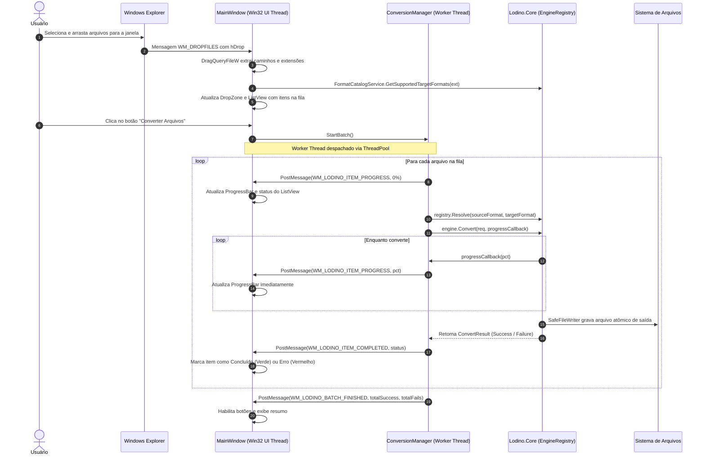

# Lodino — Especificação de Arquitetura da Aplicação Cliente Nativa Windows (Fase 10)

Especificação técnica, estrutural e operacional para a construção da interface gráfica própria do Lodino em C# (.NET Framework 4.0 BCL) utilizando estritamente chamadas diretas às APIs fundamentais do Windows (Win32 P/Invoke: User32, Gdi32, Shell32, Comctl32, Comdlg32), sem qualquer dependência de Electron, Chromium embarcado (CEF/WebView2), WPF ou WinForms.

---

## 1. Visão Geral e Princípios Arquiteturais

### 1.1 Eliminação Definitiva de Runtimes Pesados
O objetivo primário da Fase 10 é substituir integralmente a casca Electron original por um executável nativo do Windows (`Lodino.App.exe`), compilado pelo compilador nativo do sistema operacional (`csc.exe` em `C:\Windows\Microsoft.NET\Framework64\v4.0.30319\`).

| Dimensão | Versão Original (Electron) | Nova Aplicação Nativa (Win32 / C#) |
| :--- | :--- | :--- |
| **Pegada de Memória (RAM em repouso)** | ~250 MB a 400 MB | **< 15 MB** |
| **Tempo de Inicialização a Frio** | 2,5 a 4,5 segundos | **< 120 milissegundos** |
| **Dependências de Distribuição** | Runtime Chromium + Node.js (~150 MB) | **Zero dependências externas (apenas .NET 4.0 BCL padrão do Windows)** |
| **Tecnologia de Interface** | HTML5 / CSS / DOM / V8 | **Win32 API pura (User32 / Gdi32 / PixelBuffer DIB Blitting)** |
| **Responsividade de Threading** | IPC serializado via JSON | **Ponteiros em memória e Win32 `PostMessage` assíncrono** |

### 1.2 Camadas de Arquitetura do Sistema
A arquitetura é dividida em quatro camadas estritamente desacopladas:

```
┌─────────────────────────────────────────────────────────────────────────┐
│                        CAMADA DE APRESENTAÇÃO                           │
│  ┌───────────────────────────────┐     ┌─────────────────────────────┐  │
│  │   Lodino.exe (CLI nativo)     │     │  Lodino.App.exe (GUI nativo)│  │
│  │   - Console Standard I/O      │     │  - Win32 Message Loop       │  │
│  │   - Argumentos de linha       │     │  - Controles e DIB Blit     │  │
│  └──────────────┬────────────────┘     └──────────────┬──────────────┘  │
└─────────────────┼─────────────────────────────────────┼─────────────────┘
                  │                                     │
┌─────────────────▼─────────────────────────────────────▼─────────────────┐
│                CAMADA DE APLICAÇÃO E SERVIÇOS (Shared)                  │
│  - ConversionManager: Orquestrador de fila e threading pool             │
│  - ConversionQueue: Fila concorrente e estados dos itens                │
│  - PresetService: Perfis de conversão (Balanced, Quality, Web, etc.)    │
│  - HistoryService: Persistência de auditoria e sessões anteriores       │
└───────────────────────────────────┬─────────────────────────────────────┘
                                    │
┌───────────────────────────────────▼─────────────────────────────────────┐
│                     CAMADA DE NÚCLEO (Lodino.Core.dll)                  │
│  - EngineRegistry: Catálogo de motores registrados                      │
│  - ICoreEngine: Contratos de inspeção e conversão                       │
│  - Formatos: StructuredDataEngine (CSV/JSON/INI), BmpEngine, PngEngine, │
│              JpegEngine                                                 │
│  - PixelBuffer: Manipulação de matriz linear RGBA pura                  │
│  - SafeFileWriter: I/O atômico com prevenção de sobrescrita             │
└───────────────────────────────────┬─────────────────────────────────────┘
                                    │
┌───────────────────────────────────▼─────────────────────────────────────┐
│                       SISTEMA OPERACIONAL WINDOWS                       │
│  - Win32 API: User32, Gdi32, Shell32, Comctl32, Comdlg32               │
│  - File System NTFS / FAT32                                             │
└─────────────────────────────────────────────────────────────────────────┘
```

---

## 2. Seção 1: Arquitetura da Janela e Message Loop

### 2.1 Registro da Classe de Janela (`RegisterClassEx`)
A aplicação registra uma classe de janela única identificada como `"LodinoMainWindowClass"`. A classe utiliza os estilos `CS_HREDRAW`, `CS_VREDRAW` e `CS_DBLCLKS` para garantir redesenho contínuo e responsivo durante o redimensionamento.

```csharp
[StructLayout(LayoutKind.Sequential, CharSet = CharSet.Unicode)]
public struct WNDCLASSEX
{
    public uint cbSize;
    public uint style;
    public IntPtr lpfnWndProc;
    public int cbClsExtra;
    public int cbWndExtra;
    public IntPtr hInstance;
    public IntPtr hIcon;
    public IntPtr hCursor;
    public IntPtr hbrBackground;
    [MarshalAs(UnmanagedType.LPWStr)]
    public string lpszMenuName;
    [MarshalAs(UnmanagedType.LPWStr)]
    public string lpszClassName;
    public IntPtr hIconSm;
}
```

#### Prevenção Crítica contra Coleta pelo Garbage Collector (GC Pinning):
Para evitar que o delegate do `WndProc` seja movido ou coletado pelo GC durante a execução do loop Win32, o delegate é armazenado em campo estático e ancorado via `GCHandle`:
```csharp
public delegate IntPtr WndProcDelegate(IntPtr hWnd, uint msg, IntPtr wParam, IntPtr lParam);

private static WndProcDelegate _wndProcStaticDelegate;
private static GCHandle _wndProcHandle;

public static void RegisterClass(IntPtr hInstance)
{
    _wndProcStaticDelegate = new WndProcDelegate(MainWindowWndProc);
    _wndProcHandle = GCHandle.Alloc(_wndProcStaticDelegate);

    WNDCLASSEX wc = new WNDCLASSEX();
    wc.cbSize = (uint)Marshal.SizeOf(typeof(WNDCLASSEX));
    wc.style = CS_HREDRAW | CS_VREDRAW | CS_DBLCLKS;
    wc.lpfnWndProc = Marshal.GetFunctionPointerForDelegate(_wndProcStaticDelegate);
    wc.hInstance = hInstance;
    wc.hCursor = LoadCursor(IntPtr.Zero, (IntPtr)IDC_ARROW);
    wc.hbrBackground = IntPtr.Zero; // Fundo nulo para evitar flicker no double-buffering
    wc.lpszClassName = "LodinoMainWindowClass";
    wc.hIcon = LoadIcon(hInstance, (IntPtr)1);
    wc.hIconSm = LoadIcon(hInstance, (IntPtr)1);

    ushort atom = RegisterClassEx(ref wc);
    if (atom == 0)
    {
        throw new Win32Exception(Marshal.GetLastWin32Error(), "Falha ao registrar a classe de janela.");
    }
}
```

### 2.2 Criação da Janela Principal (`CreateWindowEx`)
A janela principal é criada com estilo de sobreposição padrão (`WS_OVERLAPPEDWINDOW`), com corte explícito de janelas filhas (`WS_CLIPCHILDREN`) e estilo estendido de aceitação de arquivos (`WS_EX_ACCEPTFILES` / `WS_EX_APPWINDOW`):

```csharp
IntPtr hWnd = CreateWindowEx(
    WS_EX_APPWINDOW | WS_EX_ACCEPTFILES,
    "LodinoMainWindowClass",
    "Lodino — Conversor Local de Alta Performance",
    WS_OVERLAPPEDWINDOW | WS_CLIPCHILDREN | WS_VISIBLE,
    CW_USEDEFAULT, CW_USEDEFAULT,
    1120, 740,
    IntPtr.Zero,
    IntPtr.Zero,
    hInstance,
    IntPtr.Zero
);
```

### 2.3 Laço de Despacho de Mensagens (Standard Win32 Message Loop)
O laço de despacho opera na thread de interface (STAThread). Ele processa aceleradores de teclado e navegação de caixas de diálogo (`IsDialogMessage`) para os controles filhos:

```csharp
[StructLayout(LayoutKind.Sequential)]
public struct MSG
{
    public IntPtr hwnd;
    public uint message;
    public IntPtr wParam;
    public IntPtr lParam;
    public uint time;
    public POINT pt;
}

public static int RunMessageLoop(IntPtr hWnd)
{
    MSG msg;
    while (GetMessage(out msg, IntPtr.Zero, 0, 0) > 0)
    {
        if (!IsDialogMessage(hWnd, ref msg))
        {
            TranslateMessage(ref msg);
            DispatchMessage(ref msg);
        }
    }
    return (int)msg.wParam;
}
```

### 2.4 Matriz de Tratamento de Mensagens (`WndProc`)

| Mensagem Win32 | Responsabilidade Arquitetural |
| :--- | :--- |
| `WM_CREATE` | Inicialização dos subsistemas de UI: criação de fontes Segoe UI, instanciação dos controles filhos nativos, inicialização do DIB backbuffer, registro do Drag & Drop via `DragAcceptFiles(hWnd, true)`. |
| `WM_SIZE` | Cálculo da geometria responsiva do layout de 3 colunas (Sidebar, Workspace e Desk lateral). Redimensionamento das dimensões do DIB Section de duplo buffer e reposicionamento dos controles via `DeferWindowPos` ou `MoveWindow`. |
| `WM_PAINT` | Renderização livre de flicker (double-buffered). Pintura das superfícies customizadas via `PixelBuffer` ou GDI Memory DC blit (`BitBlt` / `SetDIBitsToDevice`). Validação da região via `BeginPaint` / `EndPaint`. |
| `WM_ERASEBKGND` | Retorna `(IntPtr)1` imediatamente sem pintar para eliminar o efeito de cintilação (flicker) durante redimensionamento da janela. |
| `WM_COMMAND` | Roteamento de comandos de controles: `BN_CLICKED` (botões de ação, seleção de diretório), `CBN_SELCHANGE` (troca de formato de destino ou perfil), `EN_CHANGE` (alteração de filtros de pesquisa). |
| `WM_DROPFILES` | Intercepção nativa de arquivos arrastados do Windows Explorer. Consulta de arquivos via `DragQueryFileW`, extração de extensões e validação automática no `EngineRegistry`. Enfileiramento na `ConversionQueue` e disparo de `DragFinish(hDrop)`. |
| `WM_CTLCOLORSTATIC`<br>`WM_CTLCOLOREDIT`<br>`WM_CTLCOLORBTN` | Customização cromática de controles Win32 nativos para aplicação de tema Escuro (Dark) e Claro (Light), retornando handles para `HBRUSH` estilizados. |
| `WM_DESTROY` | Liberação de recursos GDI não gerenciados (HFONT, HBITMAP, HDC, HBRUSH), notificação de término da fila de execução e postagem de encerramento via `PostQuitMessage(0)`. |
| `WM_LODINO_*` | Mensagens customizadas de comunicação inter-threads (`WM_APP + X`) enviadas pelos workers de background. |

### 2.5 Tratamento de Drag & Drop Nativo (`WM_DROPFILES`)
Sem depender do subsistema OLE/COM complexo, o drag-and-drop utiliza a API clássica e ultra-estável da Shell do Windows:

```csharp
private static void HandleDropFiles(IntPtr hDrop)
{
    try
    {
        uint fileCount = DragQueryFile(hDrop, 0xFFFFFFFF, null, 0);
        List<string> droppedPaths = new List<string>((int)fileCount);

        for (uint i = 0; i < fileCount; i++)
        {
            uint requiredSize = DragQueryFile(hDrop, i, null, 0);
            StringBuilder sb = new StringBuilder((int)requiredSize + 1);
            DragQueryFile(hDrop, i, sb, (uint)sb.Capacity);
            string path = sb.ToString();

            if (File.Exists(path) || Directory.Exists(path))
            {
                droppedPaths.Add(path);
            }
        }

        // Despacha os caminhos para o orquestrador de aplicação
        AppServices.ConversionManager.AddFilesToQueue(droppedPaths);
    }
    finally
    {
        DragFinish(hDrop);
    }
}
```

---

## 3. Seção 2: Controles de Interface e Apresentação

### 3.1 Arquitetura Híbrida: Controles Nativos + Renderização em `PixelBuffer`
Para conciliar o desempenho máximo de desenho com a usabilidade ergonômica de formulários, o Lodino adota uma arquitetura de apresentação híbrida:

1. **Controles Win32 Nativos**: utilizados para caixas de texto com foco, botões clicáveis, caixas de combinação (ComboBox) e tabelas de arquivos (ListView).
2. **Superfícies DIB em `PixelBuffer`**: utilizadas para áreas gráficas expressivas que exigem rendering sob demanda de alta velocidade:
   - A **Zona de Drop Central** ("Arraste arquivos aqui").
   - O **Visualizador de Inspeção e Pré-visualização** (Preview de Imagens e Antes/Depois).
   - Barras de status e indicadores customizados de taxa de transferência.

```
┌────────────────────────────────────────────────────────────────────────┐
│                              JANELA NATIVA                             │
│ ┌──────────────┐ ┌───────────────────────────────────┐ ┌─────────────┐ │
│ │  FLUXO (Rail)│ │     ÁREA CENTRAL DE TRABALHO      │ │ ATIVIDADE   │ │
│ │  - Passo 01  │ │  ┌─────────────────────────────┐  │ │ (Desk)      │ │
│ │  - Passo 02  │ │  │   DropZone (PixelBuffer DIB)│  │ │ - Histórico │ │
│ │  - Passo 03  │ │  └─────────────────────────────┘  │ │ - Perfis    │ │
│ │              │ │  Controles Win32 Nativos:          │ │             │ │
│ │              │ │  [ComboBox Formato] [Botão Conv.] │ │             │ │
│ │              │ │  ┌─────────────────────────────┐  │ │             │ │
│ │              │ │  │ SysListView32 (Fila Itens)  │  │ │             │ │
│ │              │ │  └─────────────────────────────┘  │ │             │ │
│ └──────────────┘ └───────────────────────────────────┘ └─────────────┘ │
└────────────────────────────────────────────────────────────────────────┘
```

### 3.2 Inicialização de Controles Comuns do Windows (`Comctl32.dll`)
A aplicação inicializa o subsistema de controles comuns na inicialização da aplicação:

```csharp
[StructLayout(LayoutKind.Sequential)]
public struct INITCOMMONCONTROLSEX
{
    public int dwSize;
    public uint dwICC;
}

public const uint ICC_STANDARD_CLASSES   = 0x00004000;
public const uint ICC_PROGRESS_CLASS     = 0x00000020;
public const uint ICC_LISTVIEW_CLASSES   = 0x00000001;
public const uint ICC_TAB_CLASSES        = 0x00000008;

public static void InitializeCommonControls()
{
    INITCOMMONCONTROLSEX icc = new INITCOMMONCONTROLSEX();
    icc.dwSize = Marshal.SizeOf(typeof(INITCOMMONCONTROLSEX));
    icc.dwICC = ICC_STANDARD_CLASSES | ICC_PROGRESS_CLASS | ICC_LISTVIEW_CLASSES | ICC_TAB_CLASSES;
    InitCommonControlsEx(ref icc);
}
```

### 3.3 Criação Programática dos Controles de Interface
Todos os controles são instanciados via `CreateWindowExW` com identificadores inteiros de controle (`HMENU` / `CtrlId`) para tratamento desacoplado no `WM_COMMAND`:

| Controle | Classe Win32 | Estilos Fundamentais | Papel no Lodino |
| :--- | :--- | :--- | :--- |
| **Fila de Arquivos** | `SysListView32` | `WS_VISIBLE \| WS_CHILD \| LVS_REPORT \| LVS_SINGLESEL \| WS_BORDER` | Listagem dos arquivos na fila, formato detectado, status, progresso e tamanho. |
| **Barra de Progresso** | `msctls_progress32` | `WS_VISIBLE \| WS_CHILD \| PBS_SMOOTH` | Feedback visual do avanço em tempo real (0 a 100%). |
| **Combo de Formatos** | `ComboBox` | `WS_VISIBLE \| WS_CHILD \| CBS_DROPDOWNLIST \| WS_VSCROLL` | Seleção do formato de saída suportado para o arquivo atual. |
| **Combo de Perfis** | `ComboBox` | `WS_VISIBLE \| WS_CHILD \| CBS_DROPDOWNLIST \| WS_VSCROLL` | Perfis rápidos: "Equilibrado", "Menor Tamanho", "Maior Qualidade", "WhatsApp". |
| **Botão de Conversão** | `Button` | `WS_VISIBLE \| WS_CHILD \| BS_PUSHBUTTON \| BS_DEFPUSHBUTTON` | Disparo da execução da fila. |
| **Botão de Cancelamento**| `Button` | `WS_VISIBLE \| WS_CHILD \| BS_PUSHBUTTON` | Cancelamento cooperativo imediato da tarefa em execução. |
| **Botão de Destino** | `Button` | `WS_VISIBLE \| WS_CHILD \| BS_PUSHBUTTON` | Abertura do diálogo de seleção de pasta de saída. |

### 3.4 Renderização Gráfica Direta com `PixelBuffer` e `SetDIBitsToDevice`
O Lodino possui a classe `Lodino.Core.Formats.Image.PixelBuffer` que armazena pixels no padrão linear RGBA de 32 bits. Para desenhar essa matriz diretamente na janela com latência zero e sem intermediários de GDI+, a aplicação utiliza a API `SetDIBitsToDevice` com um cabeçalho `BITMAPINFO` configurado para *Top-Down DIB* (altura negativa `biHeight = -height`):

```csharp
[StructLayout(LayoutKind.Sequential)]
public struct BITMAPINFOHEADER
{
    public uint biSize;
    public int biWidth;
    public int biHeight;
    public ushort biPlanes;
    public ushort biBitCount;
    public uint biCompression;
    public uint biSizeImage;
    public int biXPelsPerMeter;
    public int biYPelsPerMeter;
    public uint biClrUsed;
    public uint biClrImportant;
}

[StructLayout(LayoutKind.Sequential)]
public struct BITMAPINFO
{
    public BITMAPINFOHEADER bmiHeader;
    public uint bmiColors;
}

public static class DibBlitter
{
    public const uint BI_RGB = 0;
    public const uint DIB_RGB_COLORS = 0;
    public const uint SRCCOPY = 0x00CC0020;

    public static void BlitPixelBuffer(IntPtr hdc, int destX, int destY, PixelBuffer buffer)
    {
        if (buffer == null || buffer.Pixels == null) return;

        BITMAPINFO bmi = new BITMAPINFO();
        bmi.bmiHeader.biSize = (uint)Marshal.SizeOf(typeof(BITMAPINFOHEADER));
        bmi.bmiHeader.biWidth = buffer.Width;
        bmi.bmiHeader.biHeight = -buffer.Height; // Altura negativa = Top-Down DIB (origem no topo esquerdo)
        bmi.bmiHeader.biPlanes = 1;
        bmi.bmiHeader.biBitCount = 32;
        bmi.bmiHeader.biCompression = BI_RGB;
        bmi.bmiHeader.biSizeImage = (uint)buffer.Pixels.Length;

        // O PixelBuffer armazena RGBA. A Win32 DIB espera BGRA.
        // A camada de apresentação executa a cópia/swizzle rápido ou utiliza buffer BGRA pré-alocado:
        byte[] bgraPixels = SwizzleRgbaToBgra(buffer.Pixels);

        unsafe
        {
            fixed (byte* pBits = bgraPixels)
            {
                SetDIBitsToDevice(
                    hdc,
                    destX, destY,
                    (uint)buffer.Width, (uint)buffer.Height,
                    0, 0,
                    0, (uint)buffer.Height,
                    (IntPtr)pBits,
                    ref bmi,
                    DIB_RGB_COLORS
                );
            }
        }
    }

    private static byte[] SwizzleRgbaToBgra(byte[] rgba)
    {
        byte[] bgra = new byte[rgba.Length];
        for (int i = 0; i < rgba.Length; i += 4)
        {
            bgra[i]     = rgba[i + 2]; // B
            bgra[i + 1] = rgba[i + 1]; // G
            bgra[i + 2] = rgba[i];     // R
            bgra[i + 3] = rgba[i + 3]; // A
        }
        return bgra;
    }
}
```

### 3.5 Sistema de Temas e Cores (Dark e Light)
A aplicação implementa um sistema de temas configurável sem CSS, utilizando a interceptação das mensagens `WM_CTLCOLOR*` e cores GDI:

| Token Visual | Tema Escuro (Padrão) | Tema Claro |
| :--- | :--- | :--- |
| **Janela / Background Principal** | `#1E1E24` (`RGB(30, 30, 36)`) | `#F5F6F8` (`RGB(245, 246, 248)`) |
| **Cartões e Superfícies** | `#26262E` (`RGB(38, 38, 46)`) | `#FFFFFF` (`RGB(255, 255, 255)`) |
| **Cor de Acento (Primária)** | `#0078D4` (`RGB(0, 120, 212)`) | `#0066CC` (`RGB(0, 102, 204)`) |
| **Texto Primário** | `#FFFFFF` (`RGB(255, 255, 255)`) | `#1A1A1A` (`RGB(26, 26, 26)`) |
| **Texto Secundário / Mudo** | `#A0A0A8` (`RGB(160, 160, 168)`) | `#6A6A72` (`RGB(106, 106, 114)`) |
| **Bordas e Divisores** | `#383842` (`RGB(56, 56, 66)`) | `#DCE0E6` (`RGB(220, 224, 230)`) |
| **Feedback de Sucesso** | `#107C41` (`RGB(16, 124, 65)`) | `#0E703B` (`RGB(14, 112, 59)`) |
| **Feedback de Erro** | `#D83B01` (`RGB(216, 59, 1)`) | `#C43100` (`RGB(196, 49, 0)`) |

### 3.6 Diálogos Padrão de Arquivos e Pastas (`Comdlg32` e `Shell32`)
A aplicação abre diálogos nativos do sistema sem instanciar classes de WinForms:

#### Diálogo de Seleção de Arquivos (`GetOpenFileName`):
```csharp
[StructLayout(LayoutKind.Sequential, CharSet = CharSet.Unicode)]
public struct OPENFILENAME
{
    public int lStructSize;
    public IntPtr hwndOwner;
    public IntPtr hInstance;
    [MarshalAs(UnmanagedType.LPWStr)]
    public string lpstrFilter;
    [MarshalAs(UnmanagedType.LPWStr)]
    public string lpstrCustomFilter;
    public int nMaxCustFilter;
    public int nFilterIndex;
    public IntPtr lpstrFile;
    public int nMaxFile;
    public IntPtr lpstrFileTitle;
    public int nMaxFileTitle;
    [MarshalAs(UnmanagedType.LPWStr)]
    public string lpstrInitialDir;
    [MarshalAs(UnmanagedType.LPWStr)]
    public string lpstrTitle;
    public int Flags;
    public ushort nFileOffset;
    public ushort nFileExtension;
    [MarshalAs(UnmanagedType.LPWStr)]
    public string lpstrDefExt;
    public IntPtr lCustData;
    public IntPtr lpfnHook;
    [MarshalAs(UnmanagedType.LPWStr)]
    public string lpTemplateName;
    public IntPtr pvReserved;
    public int dwReserved;
    public int FlagsEx;
}

public const int OFN_EXPLORER        = 0x00080000;
public const int OFN_FILEMUSTEXIST   = 0x00001000;
public const int OFN_ALLOWMULTISELECT = 0x00000200;
public const int OFN_PATHMUSTEXIST   = 0x00000800;

public static List<string> ShowOpenFilePicker(IntPtr ownerHwnd, string filter, string title)
{
    OPENFILENAME ofn = new OPENFILENAME();
    ofn.lStructSize = Marshal.SizeOf(typeof(OPENFILENAME));
    ofn.hwndOwner = ownerHwnd;
    ofn.lpstrFilter = filter.Replace('|', '\0') + "\0";
    ofn.lpstrTitle = title ?? "Selecionar Arquivos para Conversão";
    ofn.Flags = OFN_EXPLORER | OFN_FILEMUSTEXIST | OFN_PATHMUSTEXIST | OFN_ALLOWMULTISELECT;

    int bufferSize = 65536; // 64 KB buffer para acomodar centenas de arquivos selecionados
    IntPtr fileBuffer = Marshal.AllocHGlobal(bufferSize * 2);
    try
    {
        Marshal.WriteInt16(fileBuffer, 0);
        ofn.lpstrFile = fileBuffer;
        ofn.nMaxFile = bufferSize;

        if (GetOpenFileName(ref ofn))
        {
            return ParseMultiSelectBuffer(fileBuffer);
        }
        return new List<string>(0);
    }
    finally
    {
        Marshal.FreeHGlobal(fileBuffer);
    }
}
```

#### Diálogo de Seleção de Pasta (`SHBrowseForFolder`):
```csharp
[StructLayout(LayoutKind.Sequential, CharSet = CharSet.Unicode)]
public struct BROWSEINFO
{
    public IntPtr hwndOwner;
    public IntPtr pidlRoot;
    public IntPtr pszDisplayName;
    [MarshalAs(UnmanagedType.LPWStr)]
    public string lpszTitle;
    public uint ulFlags;
    public IntPtr lpfn;
    public IntPtr lParam;
    public int iImage;
}

public const uint BIF_RETURNONLYFSDIRS = 0x00000001;
public const uint BIF_NEWDIALOGSTYLE   = 0x00000040;

public static string ShowFolderPicker(IntPtr ownerHwnd, string title)
{
    BROWSEINFO bi = new BROWSEINFO();
    bi.hwndOwner = ownerHwnd;
    bi.lpszTitle = title ?? "Selecione o diretório de destino";
    bi.ulFlags = BIF_RETURNONLYFSDIRS | BIF_NEWDIALOGSTYLE;

    IntPtr pidl = SHBrowseForFolder(ref bi);
    if (pidl != IntPtr.Zero)
    {
        StringBuilder path = new StringBuilder(260);
        if (SHGetPathFromIDList(pidl, path))
        {
            Marshal.FreeCoTaskMem(pidl);
            return path.ToString();
        }
        Marshal.FreeCoTaskMem(pidl);
    }
    return null;
}
```

---

## 4. Seção 3: Arquitetura de Estado, Fila de Conversão e Assincronismo

### 4.1 Modelo de Threading e Não-Bloqueio
O maior risco em clientes desktop é o travamento do laço de mensagens (UI Freeze / "Não Respondendo") ao processar arquivos pesados. A arquitetura estabelece uma regra estrita de separação:

1. **Thread Principal de UI (STA)**: Dedicada com exclusividade a despachar mensagens do Windows (`GetMessage`/`DispatchMessage`), atualizar posições dos controles e responder aos cliques do usuário.
2. **Worker Threads de Conversão (Background)**: Executam o pipeline pesado de decodificação, processamento matricial e codificação do `Lodino.Core.dll`.

```
[ Thread da Interface (STA / UI) ]
   │
   ├─► Usuário arrasta arquivos (WM_DROPFILES)
   ├─► Adiciona itens na ConversionQueue
   ├─► Dispara processamento assíncrono ────────────────────────┐
   │                                                             │
   │   [ Fila de Mensagens do Windows ]                          ▼
   │          ▲                                      [ Worker Thread de Background ]
   │          │                                         │
   │          ├────── PostMessage(WM_PROGRESS, pct) ◄───┤ Executa engine.Convert()
   │          │                                         │ Invoca progressCallback(pct)
   │          ├────── PostMessage(WM_COMPLETED, res) ◄──┤ Finaliza conversão
   │          │                                         │
   ▼          ▼                                         ▼
[ WndProc recebe WM_* ]
   ├─► Atualiza ProgressBar (SendMessage PBM_SETPOS)
   └─► Atualiza ListView com status e tempo decorrido
```

### 4.2 Definição de Mensagens Customizadas da Aplicação (`WM_APP`)
A comunicação da thread trabalhadora para a thread principal de UI ocorre via `PostMessage` com identificadores baseados em `WM_APP (0x8000)`. Ao contrário de `SendMessage`, `PostMessage` é assíncrono e retorna imediatamente para o worker, sem risco de deadlock.

```csharp
public static class LodinoAppMessages
{
    public const uint WM_APP = 0x8000;

    /// <summary>
    /// Notificação de atualização de progresso de um item.
    /// wParam: Índice do item na fila (int)
    /// lParam: Percentual de progresso concluído (0 a 100)
    /// </summary>
    public const uint WM_LODINO_ITEM_PROGRESS  = WM_APP + 101;

    /// <summary>
    /// Notificação de término (sucesso ou falha) de um item.
    /// wParam: Índice do item na fila (int)
    /// lParam: Código de status (1 = sucesso, 2 = erro, 3 = cancelado)
    /// </summary>
    public const uint WM_LODINO_ITEM_COMPLETED = WM_APP + 102;

    /// <summary>
    /// Notificação de finalização do lote completo de conversão.
    /// wParam: Total de sucessos (int)
    /// lParam: Total de falhas (int)
    /// </summary>
    public const uint WM_LODINO_BATCH_FINISHED = WM_APP + 103;

    /// <summary>
    /// Notificação de alteração de itens na fila (adição, remoção, reordenação).
    /// </summary>
    public const uint WM_LODINO_QUEUE_CHANGED  = WM_APP + 104;
}
```

### 4.3 Estrutura da Fila e Estado (`ConversionQueue` e `ConversionItem`)

```csharp
public enum ConversionStatus
{
    Queued,
    Inspecting,
    Converting,
    Completed,
    Failed,
    Cancelled
}

public class ConversionItem
{
    public string ItemId { get; private set; }
    public string InputPath { get; set; }
    public string SourceFormat { get; set; }
    public string TargetFormat { get; set; }
    public string OutputDirectory { get; set; }
    public Dictionary<string, string> Settings { get; private set; }
    
    public ConversionStatus Status { get; set; }
    public int ProgressPercentage { get; set; }
    public ConvertResult Result { get; set; }
    public string ErrorMessage { get; set; }
    public long FileSizeBytes { get; set; }
    public long ElapsedMs { get; set; }

    public ConversionItem(string inputPath, string targetFormat, string outputDir)
    {
        ItemId = Guid.NewGuid().ToString("N");
        InputPath = inputPath;
        SourceFormat = Path.GetExtension(inputPath).TrimStart('.').ToLowerInvariant();
        TargetFormat = targetFormat;
        OutputDirectory = outputDir;
        Settings = new Dictionary<string, string>(StringComparer.OrdinalIgnoreCase);
        Status = ConversionStatus.Queued;
    }
}
```

### 4.4 Orquestrador de Execução e Cancelamento Cooperativo (`ConversionManager`)
O gerenciador controla o despacho sequencial ou paralelo dos itens da fila e mantém uma flag volátil de cancelamento cooperativo:

```csharp
public class ConversionManager
{
    private readonly object _syncRoot = new object();
    private readonly List<ConversionItem> _items = new List<ConversionItem>();
    private volatile bool _cancelRequested = false;
    private volatile bool _isRunning = false;
    private IntPtr _notifyHwnd;

    public void Initialize(IntPtr notifyHwnd)
    {
        _notifyHwnd = notifyHwnd;
    }

    public void AddItems(IEnumerable<string> filePaths, string defaultTargetFormat, string outputDir)
    {
        lock (_syncRoot)
        {
            foreach (var path in filePaths)
            {
                var item = new ConversionItem(path, defaultTargetFormat, outputDir);
                if (File.Exists(path))
                {
                    item.FileSizeBytes = new FileInfo(path).Length;
                }
                _items.Add(item);
            }
        }
        PostMessage(_notifyHwnd, LodinoAppMessages.WM_LODINO_QUEUE_CHANGED, IntPtr.Zero, IntPtr.Zero);
    }

    public void StartBatch()
    {
        lock (_syncRoot)
        {
            if (_isRunning) return;
            _isRunning = true;
            _cancelRequested = false;
        }

        ThreadPool.QueueUserWorkItem(ExecuteBatchWorker);
    }

    public void RequestCancel()
    {
        _cancelRequested = true;
    }

    private void ExecuteBatchWorker(object state)
    {
        int successCount = 0;
        int failCount = 0;

        for (int i = 0; i < _items.Count; i++)
        {
            if (_cancelRequested)
            {
                MarkRemainingCancelled(i);
                break;
            }

            ConversionItem item = _items[i];
            item.Status = ConversionStatus.Converting;
            PostMessage(_notifyHwnd, LodinoAppMessages.WM_LODINO_ITEM_PROGRESS, (IntPtr)i, (IntPtr)0);

            var sw = System.Diagnostics.Stopwatch.StartNew();
            try
            {
                var registry = EngineRegistry.Default;
                var engine = registry.Resolve(item.SourceFormat, item.TargetFormat);

                var req = new ConvertRequest
                {
                    JobId = item.ItemId,
                    InputPath = item.InputPath,
                    TargetFormat = item.TargetFormat,
                    OutputDirectory = item.OutputDirectory
                };
                foreach (var kvp in item.Settings)
                {
                    req.Settings[kvp.Key] = kvp.Value;
                }

                int lastReportedPct = -1;
                var result = engine.Convert(req, pct =>
                {
                    if (pct != lastReportedPct)
                    {
                        lastReportedPct = pct;
                        item.ProgressPercentage = pct;
                        PostMessage(_notifyHwnd, LodinoAppMessages.WM_LODINO_ITEM_PROGRESS, (IntPtr)i, (IntPtr)pct);
                    }
                });

                sw.Stop();
                item.ElapsedMs = sw.ElapsedMilliseconds;
                item.Result = result;

                if (result.Status == "completed")
                {
                    item.Status = ConversionStatus.Completed;
                    successCount++;
                    PostMessage(_notifyHwnd, LodinoAppMessages.WM_LODINO_ITEM_COMPLETED, (IntPtr)i, (IntPtr)1);
                }
                else
                {
                    item.Status = ConversionStatus.Failed;
                    item.ErrorMessage = result.ErrorMessage;
                    failCount++;
                    PostMessage(_notifyHwnd, LodinoAppMessages.WM_LODINO_ITEM_COMPLETED, (IntPtr)i, (IntPtr)2);
                }
            }
            catch (Exception ex)
            {
                sw.Stop();
                item.ElapsedMs = sw.ElapsedMilliseconds;
                item.Status = ConversionStatus.Failed;
                item.ErrorMessage = ex.Message;
                failCount++;
                AppLogger.LogError(string.Format("Falha no item {0}: {1}", item.InputPath, ex.ToString()));
                PostMessage(_notifyHwnd, LodinoAppMessages.WM_LODINO_ITEM_COMPLETED, (IntPtr)i, (IntPtr)2);
            }
        }

        lock (_syncRoot)
        {
            _isRunning = false;
        }

        PostMessage(_notifyHwnd, LodinoAppMessages.WM_LODINO_BATCH_FINISHED, (IntPtr)successCount, (IntPtr)failCount);
    }

    private void MarkRemainingCancelled(int startIndex)
    {
        for (int i = startIndex; i < _items.Count; i++)
        {
            _items[i].Status = ConversionStatus.Cancelled;
            _items[i].ErrorMessage = "Conversão cancelada pelo usuário.";
            PostMessage(_notifyHwnd, LodinoAppMessages.WM_LODINO_ITEM_COMPLETED, (IntPtr)i, (IntPtr)3);
        }
    }
}
```

### 4.5 Logging e Tratamento Estruturado de Erros
A aplicação utiliza o `SafeFileWriter` do núcleo para registrar logs atômicos sem dependências de frameworks externos:

```csharp
public static class AppLogger
{
    private static readonly object _logLock = new object();
    private static readonly string _logFile = Path.Combine(
        Environment.GetFolderPath(Environment.SpecialFolder.LocalApplicationData),
        "Lodino",
        "lodino-app.log"
    );

    public static void LogInfo(string message)
    {
        WriteEntry("INFO", message);
    }

    public static void LogError(string message)
    {
        WriteEntry("ERROR", message);
    }

    private static void WriteEntry(string level, string message)
    {
        lock (_logLock)
        {
            try
            {
                string dir = Path.GetDirectoryName(_logFile);
                if (!Directory.Exists(dir)) Directory.CreateDirectory(dir);

                string line = string.Format("[{0:yyyy-MM-dd HH:mm:ss.fff}] [{1}] [Thread {2}] {3}{4}",
                    DateTime.Now, level, Thread.CurrentThread.ManagedThreadId, message, Environment.NewLine);

                File.AppendAllText(_logFile, line, Encoding.UTF8);
            }
            catch
            {
                // Silencioso para não abortar a aplicação se o disco estiver bloqueado
            }
        }
    }
}
```

---

## 5. Seção 4: Integração com o Núcleo (`Lodino.Core.dll`) e Desacoplamento

### 5.1 Desacoplamento de Serviços (Shared Application Services)
Para garantir que a CLI (`Lodino.exe`) e a GUI nativa (`Lodino.App.exe`) compartilhem exatamente as mesmas regras de negócio sem duplicação de lógica, os componentes de orquestração residem no namespace compartilhado `Lodino.Application`:

```
                    ┌────────────────────────────┐
                    │    EngineRegistry.Default  │
                    └──────────────┬─────────────┘
                                   │
              ┌────────────────────┴────────────────────┐
              ▼                                         ▼
┌───────────────────────────┐             ┌───────────────────────────┐
│     BatchConversionEngine │             │      PresetCatalog        │
│  - Orquestra execução     │             │  - Balanced (Q:80)        │
│  - Monitora progresso %   │             │  - Quality (Q:95)         │
│  - Trata exceções do core │             │  - WhatsApp (Q:65, 1280px)│
└─────────────┬─────────────┘             └─────────────┬─────────────┘
              │                                         │
              ├─────────────────────────────────────────┤
              ▼                                         ▼
┌───────────────────────────┐             ┌───────────────────────────┐
│    Lodino.exe (CLI)       │             │   Lodino.App.exe (GUI)    │
│  Console.WriteLine(pct)   │             │   PostMessage(WM_PROGRESS)│
└───────────────────────────┘             └───────────────────────────┘
```

### 5.2 Catálogo Dinâmico de Formatos Suportados
A UI consulta o `EngineRegistry.Default` em tempo de execução para preencher os seletores de formato de saída com base na extensão do arquivo selecionado:

```csharp
public static class FormatCatalogService
{
    public static List<string> GetSupportedTargetFormats(string sourceExtension)
    {
        if (string.IsNullOrEmpty(sourceExtension)) return new List<string>(0);
        string cleanExt = sourceExtension.TrimStart('.').ToLowerInvariant();

        var registry = EngineRegistry.Default;
        HashSet<string> supportedTargets = new HashSet<string>(StringComparer.OrdinalIgnoreCase);

        foreach (var engine in registry.GetAll())
        {
            if (engine.CanConvert(cleanExt, cleanExt) || 
                engine.SupportedInputs.Any(inp => string.Equals(inp, cleanExt, StringComparison.OrdinalIgnoreCase)))
            {
                foreach (var outFmt in engine.SupportedOutputs)
                {
                    supportedTargets.Add(outFmt);
                }
            }
        }

        return new List<string>(supportedTargets);
    }
}
```

### 5.3 Catálogo de Perfis Pré-Definidos (Presets)
A aplicação reproduz os perfis nativos presentes na especificação original:

| Perfil | Identificador | Configurações Automáticas |
| :--- | :--- | :--- |
| **Equilibrado** | `balanced` | Qualidade 80, sem redimensionamento forçado, preservação de metadados padrão. |
| **Arquivo Menor** | `small` | Qualidade 50, compressão otimizada, remoção de metadados redundantes. |
| **Alta Qualidade** | `quality` | Qualidade 95, preservação integral de canais de cor e metadados. |
| **WhatsApp** | `whatsapp` | Qualidade 70, largura máxima de 1280px (preservando aspect ratio), remoção de metadados. |
| **Impressão** | `print` | Qualidade 100, DPI 300, amostragem cromática 4:4:4 integral. |

```csharp
public class Preset
{
    public string Id { get; set; }
    public string DisplayName { get; set; }
    public Dictionary<string, string> Settings { get; private set; }

    public Preset(string id, string name)
    {
        Id = id;
        DisplayName = name;
        Settings = new Dictionary<string, string>(StringComparer.OrdinalIgnoreCase);
    }
}

public static class PresetCatalog
{
    public static readonly Preset Balanced = new Preset("balanced", "Equilibrado")
        .With("quality", "80");

    public static readonly Preset Small = new Preset("small", "Arquivo Menor")
        .With("quality", "50")
        .With("stripMetadata", "true");

    public static readonly Preset Quality = new Preset("quality", "Alta Fidelidade")
        .With("quality", "95");

    public static readonly Preset WhatsApp = new Preset("whatsapp", "WhatsApp Otimizado")
        .With("quality", "70")
        .With("maxWidth", "1280")
        .With("maxHeight", "1280");

    private static Preset With(this Preset p, string key, string value)
    {
        p.Settings[key] = value;
        return p;
    }
}
```

---

## 6. Diagramas de Sequência e Fluxo de Execução

### 6.1 Fluxo Ponta a Ponta de Conversão na Interface Nativa


---

## 7. Assinaturas P/Invoke Completas e Structs Fundamentais

A tabela abaixo compila as assinaturas e convenções de chamada estritas para interoperabilidade com o Windows 64-bit e 32-bit:

```csharp
internal static class NativeMethods
{
    // User32.dll
    [DllImport("user32.dll", SetLastError = true, CharSet = CharSet.Unicode)]
    public static extern ushort RegisterClassEx([In] ref WNDCLASSEX lpwcx);

    [DllImport("user32.dll", SetLastError = true, CharSet = CharSet.Unicode)]
    public static extern IntPtr CreateWindowEx(
        uint dwExStyle,
        string lpClassName,
        string lpWindowName,
        uint dwStyle,
        int x, int y,
        int nWidth, int nHeight,
        IntPtr hWndParent,
        IntPtr hMenu,
        IntPtr hInstance,
        IntPtr lpParam
    );

    [DllImport("user32.dll")]
    public static extern bool DestroyWindow(IntPtr hWnd);

    [DllImport("user32.dll")]
    public static extern int GetMessage(out MSG lpMsg, IntPtr hWnd, uint wMsgFilterMin, uint wMsgFilterMax);

    [DllImport("user32.dll")]
    public static extern bool TranslateMessage([In] ref MSG lpMsg);

    [DllImport("user32.dll")]
    public static extern IntPtr DispatchMessage([In] ref MSG lpMsg);

    [DllImport("user32.dll")]
    public static extern bool IsDialogMessage(IntPtr hDlg, [In] ref MSG lpMsg);

    [DllImport("user32.dll")]
    public static extern void PostQuitMessage(int nExitCode);

    [DllImport("user32.dll")]
    public static extern IntPtr DefWindowProc(IntPtr hWnd, uint uMsg, IntPtr wParam, IntPtr lParam);

    [DllImport("user32.dll")]
    public static extern bool PostMessage(IntPtr hWnd, uint Msg, IntPtr wParam, IntPtr lParam);

    [DllImport("user32.dll")]
    public static extern IntPtr SendMessage(IntPtr hWnd, uint Msg, IntPtr wParam, IntPtr lParam);

    [DllImport("user32.dll")]
    public static extern IntPtr BeginPaint(IntPtr hWnd, out PAINTSTRUCT lpPaint);

    [DllImport("user32.dll")]
    public static extern bool EndPaint(IntPtr hWnd, [In] ref PAINTSTRUCT lpPaint);

    [DllImport("user32.dll")]
    public static extern bool InvalidateRect(IntPtr hWnd, IntPtr lpRect, bool bErase);

    [DllImport("user32.dll")]
    public static extern bool MoveWindow(IntPtr hWnd, int X, int Y, int nWidth, int nHeight, bool bRepaint);

    [DllImport("user32.dll")]
    public static extern IntPtr LoadCursor(IntPtr hInstance, IntPtr lpCursorName);

    [DllImport("user32.dll")]
    public static extern IntPtr LoadIcon(IntPtr hInstance, IntPtr lpIconName);

    [DllImport("user32.dll", SetLastError = true, CharSet = CharSet.Unicode)]
    public static extern int MessageBox(IntPtr hWnd, string text, string caption, uint type);

    // Shell32.dll (Drag and Drop & Folder Browse)
    [DllImport("shell32.dll")]
    public static extern void DragAcceptFiles(IntPtr hWnd, bool fAccept);

    [DllImport("shell32.dll", CharSet = CharSet.Unicode)]
    public static extern uint DragQueryFile(IntPtr hDrop, uint iFile, [Out] StringBuilder lpszFile, uint cch);

    [DllImport("shell32.dll")]
    public static extern void DragFinish(IntPtr hDrop);

    [DllImport("shell32.dll", CharSet = CharSet.Unicode)]
    public static extern IntPtr SHBrowseForFolder(ref BROWSEINFO lpbi);

    [DllImport("shell32.dll", CharSet = CharSet.Unicode)]
    public static extern bool SHGetPathFromIDList(IntPtr pidl, [Out] StringBuilder pszPath);

    // Gdi32.dll
    [DllImport("gdi32.dll")]
    public static extern int SetDIBitsToDevice(
        IntPtr hdc,
        int xDest, int yDest,
        uint w, uint h,
        int xSrc, int ySrc,
        uint uStartScan, uint cScanLines,
        IntPtr lpvBits,
        [In] ref BITMAPINFO lpbmi,
        uint fuColorUse
    );

    [DllImport("gdi32.dll", SetLastError = true, CharSet = CharSet.Unicode)]
    public static extern IntPtr CreateFont(
        int cHeight, int cWidth, int cEscapement, int cOrientation,
        int cWeight, uint bItalic, uint bUnderline, uint bStrikeOut,
        uint iCharSet, uint iOutPrecision, uint iClipPrecision,
        uint iQuality, uint iPitchAndFamily, string pszFaceName
    );

    [DllImport("gdi32.dll")]
    public static extern IntPtr CreateSolidBrush(uint crColor);

    [DllImport("gdi32.dll")]
    public static extern bool DeleteObject(IntPtr hObject);

    // Comctl32.dll
    [DllImport("comctl32.dll")]
    public static extern bool InitCommonControlsEx([In] ref INITCOMMONCONTROLSEX icc);

    // Comdlg32.dll
    [DllImport("comdlg32.dll", SetLastError = true, CharSet = CharSet.Unicode)]
    public static extern bool GetOpenFileName([In, Out] ref OPENFILENAME lpofn);

    [DllImport("comdlg32.dll", SetLastError = true, CharSet = CharSet.Unicode)]
    public static extern bool GetSaveFileName([In, Out] ref OPENFILENAME lpofn);

    // Kernel32.dll
    [DllImport("kernel32.dll", CharSet = CharSet.Unicode)]
    public static extern IntPtr GetModuleHandle(string lpModuleName);
}
```

---

## 8. Primeiro Marco Funcional (Milestone 1 — Prova de Conceito Concreta)

### 8.1 Escopo do Primeiro Marco Funcional
1. **Estrutura de Código Fonte**:
   - Criação do diretório `src/desktop/` (ou `src/app/`) contendo a implementação da janela Win32 nativa.
   - Componentes:
     - `NativeMethods.cs`: P/Invoke isolado com validações de erro estritas.
     - `LodinoWindow.cs`: Implementação da janela principal, layout responsivo e roteamento de mensagens.
     - `ConversionManager.cs`: Orquestrador assíncrono da fila e conexão ao `Lodino.Core.dll`.
     - `Program.cs`: Ponto de entrada STA da aplicação nativa (`Lodino.App.exe`).
2. **Funcionalidades Operacionais**:
   - Janela principal abre instantaneamente sem dependência de Chromium ou WinForms.
   - Suporte nativo a Drag & Drop de arquivos (BMP, PNG, JPEG, CSV, JSON, INI).
   - Detecção automática de formatos suportados no `EngineRegistry`.
   - Conversão acionada por clique de botão ou automática.
   - Barra de progresso atualizada dinamicamente via `WM_LODINO_ITEM_PROGRESS`.
   - Conclusão com feedback visual claro (sucesso, tempo de conversão, arquivo gerado).
3. **Pipeline de Compilação (`scripts/build-native-app.ps1`)**:
   - Compilação via `csc.exe /target:winexe` referenciando `build/Lodino.Core.dll`.
   - Geração de `build/Lodino.App.exe` (< 100 KB de executável!).

---

## 9. Conclusão e Próximos Passos
Esta especificação consolida a transição definitiva para a arquitetura proprietária nativa do Lodino, garantindo consumo ínfimo de recursos, latência zero de interface e conformidade irrestrita com os requisitos de isolamento tecnológico estabelecidos para a Fase 10.
