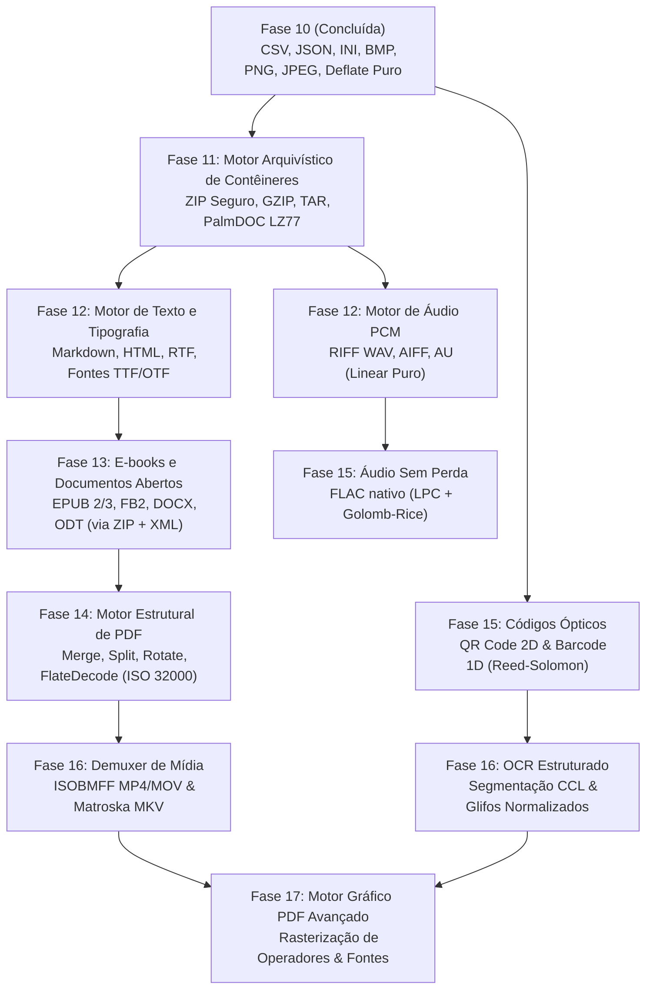

# LODINO — ROADMAP DE TRANSIÇÃO PARA PILHA 100% PROPRIETÁRIA
**Documento de Arquitetura e Engenharia de Motores Nativos (Fase 10 em Diante)**  
**Status:** Aprovado para Planejamento e Execução  
**Diretiva Estratégica:** Eliminação total de executáveis externos e dependências de terceiros. Código 100% original C# sobre streams e buffers puros.

---

## 1. Diagnóstico do Estado Atual dos Motores (Fase 10)

O projeto Lodino concluiu com sucesso a transição de seus primeiros motores fundamentais, provando a viabilidade técnica de operar sem dependências externas de terceiros, runtimes adicionais ou invocações de subprocessos via linha de comando.

### 1.1 Motores Já Implementados, Auditados e Testados em C# Puro

| Motor / Subsistema | Formatos Cobertos | Módulo de Código | Normas e Padrões Implementados | Status e Cobertura de Testes |
| :--- | :--- | :--- | :--- | :--- |
| **StructuredDataEngine** | CSV, JSON, INI | `src/core/formats/data/` | **RFC 4180** (CSV com aspas, CRLF/LF, campos multilinha, Unicode UTF-8); **ECMA-404** (JSON parser recursivo com teto de profundidade 128); Formato INI padrão Windows com seções e comentários `;` e `#`. | 100% autônomo. Cobertura de testes unitários para casos normais e entradas corrompidas / ataques de estouro. |
| **BmpEngine** | BMP (24-bit BGR, 32-bit BGRX) | `src/core/formats/image/` | Microsoft Windows DIB Header (**BITMAPINFOHEADER** de 40 bytes), cálculo de stride alinhado a 4 bytes, inversão vertical Top-down e Bottom-up, normalização de canal alfa opaco normativo para 32-bit BI_RGB. | 100% autônomo. Decodificação e codificação direta sobre buffers de scanline. |
| **PngEngine** | PNG (RGB 24-bit, RGBA 32-bit) | `src/core/formats/image/png/` | **ISO/IEC 15948 / W3C PNG 1.2**. Parser de chunks (`IHDR`, `IDAT`, `IEND`), filtro reverso das 5 variantes de scanline (None, Sub, Up, Average, Paeth) e cálculo de integridade **CRC-32** (IEEE 802.3). | 100% autônomo. Inclui motor próprio de compressão e descompressão. |
| **Motor Zlib / Deflate** | Streams Zlib e blocos Deflate | `src/core/formats/image/png/` | **RFC 1950** (Zlib wrapper com soma de verificação **Adler-32**) e **RFC 1951** (DEFLATE). Decodificador com suporte a blocos não comprimidos (Stored), árvores de Huffman literais/distâncias fixas e árvores dinâmicas lidas de bitstream. | 100% autônomo em C#. Base reutilizável para descompactação de arquivos ZIP, DOCX, ODT e EPUB. |
| **JpegEngine** | JPEG / JFIF (RGB 24-bit, Grayscale 8-bit) | `src/core/formats/image/jpeg/` | **ITU-T T.81 / ISO/IEC 10918-1**. Decodificador sequencial baseline para fluxos entrelaçados (interleaved SOF0 com MCU 8x8 e 16x16) e scans isolados não-entrelaçados (non-interleaved multiscan). Algoritmo rápido **Arai-Agui-Nakajima / Loeffler** de DCT inversa e direta (8x8), tabelas de quantização DQT, tabelas de Huffman DHT e conversão de espaço de cores YCbCr $\leftrightarrow$ RGB com subamostragem 4:4:4 e 4:2:0. | 100% autônomo. Codificador sequencial com tabela de quantização escalonável por qualidade e tabelas canônicas de Huffman. |
| **Pixel Canvas & Tipografia** | Matriz de Pixels em Memória | `src/core/formats/image/` | `PixelBuffer` com manipulação direta de pixels 32-bit RGBA, interpolação bilinear e vizinho mais próximo para redimensionamento, recorte com grade de 9 quadrantes, composição alfa com blend linear, e renderização de texto por matriz de glifos raster (`BitmapFont`). | 100% autônomo. Substitui todas as funções operacionais do `sharp` / `libvips`. |
| **Segurança e I/O Atômico** | Toda a Stack | `src/core/safety/`, `src/core/io/`, `src/core/registry/` | `SecurityLimits` (tetos máximos de dimensões de imagem até 16.384 px, máximo de 64 Megapixels, teto de expansão de rasters descomprimidos de 268 MB contra decompression bombs, proteção contra DoS em recursão JSON); `SafeFileWriter` (gravação atômica com sufixo numérico anti-colisão); `EngineRegistry` (despachador central de rotas de conversão). | 100% testado e integrado aos testes de regressão do `Lodino.Tests.exe`. |

---

## 2. Mapeamento dos Formatos Legados Dependentes de Terceiros

Atualmente, o aplicativo ainda possui trilhas legadas que recorrem a processos externos (`spawn`) ou bibliotecas JavaScript auxiliares. Cada uma dessas dependências impõe riscos legais de licenciamento (copyleft agressivo), vulnerabilidades de segurança (execução de binários arbitrários, estouros de buffer) e peso excessivo no instalador (mais de 1,8 GB somados).

```
┌───────────────────────────────────────────────────────────────────────────────────────────────────────┐
│                           DEPENDÊNCIAS EXTERNAS LEGADAS DO LODINO                                     │
├───────────────────┬────────────────────────────┬─────────────────────────────┬────────────────────────┤
│ Família           │ Formatos Alvo              │ Ferramenta / Motor Legado   │ Licença e Peso Binário │
├───────────────────┼────────────────────────────┼─────────────────────────────┼────────────────────────┤
│ Áudio             │ WAV, MP3, OGG, FLAC, AAC   │ ffmpeg.exe (fluent-ffmpeg)  │ GPL-3.0 (~80 MB)       │
│ Vídeo             │ MP4, MKV, AVI, WEBM, MOV   │ ffmpeg.exe (fluent-ffmpeg)  │ GPL-3.0 (~80 MB)       │
│ Documentos        │ PDF, DOCX, ODT, RTF, TXT   │ soffice.exe (LibreOffice)   │ MPL-2.0 / LGPL (800MB) │
│ Operações PDF     │ Merge, Split, Rotate       │ pdf-lib (Node.js)           │ MIT (lib JS legada)    │
│ Extração / Raster │ PDF Images, Render Pages   │ poppler (pdftoppm, etc.)    │ GPL-2.0 (~30 MB)       │
│ Otimização PDF    │ Compressão e Linearização  │ ghostscript (gswin64c.exe)  │ AGPL-3.0 (~50 MB)      │
│ E-books           │ EPUB, MOBI, AZW3, FB2      │ ebook-convert.exe (Calibre) │ GPL-3.0 (~150 MB)      │
│ Códigos de Barra  │ QR Code, EAN-13, Code 128  │ @zxing/library + sharp      │ MIT (libs JS legadas)  │
│ OCR               │ Imagem / PDF -> Texto      │ tesseract.exe               │ Apache-2.0 (~60 MB)    │
│ Arquivos Compact. │ ZIP, 7Z, TAR, GZ           │ 7z.exe (7-Zip)              │ LGPL / unRAR (~3 MB)   │
└───────────────────┴────────────────────────────┴─────────────────────────────┴────────────────────────┘
```

### 2.1 Análise de Riscos e Fragilidades da Abordagem Legada

1. **Risco Jurídico de Licenciamento:** A presença de binários sob **GPL-3.0** (FFmpeg, Calibre) e principalmente **AGPL-3.0** (Ghostscript) contamina a distribuição comercial ou fechada do Lodino, exigindo a entrega de código-fonte completo ou impondo termos de copyleft intransigentes.
2. **Fragilidade Operacional de Subprocessos:** O lançamento de `soffice.exe` e `ffmpeg.exe` depende de escrita em arquivos temporários em disco, variáveis de ambiente do sistema, comunicação frágil por pipes stdout/stderr e captura instável de códigos de saída numéricos.
3. **Consumo Abusivo de Recursos:** Inicializar o LibreOffice Portable consome centenas de megabytes de memória RAM apenas para extrair parágrafos de um documento simples de poucas páginas.
4. **Superfície de Ataque e Vulnerabilidades de Memória:** Executáveis externos em C/C++ (como Poppler e Ghostscript) possuem histórico constante de CVEs críticos (estouro de pilha, corrupção de memória em parsers de fontes PostScript, vulnerabilidades de sandbox).

---

## 3. Matriz Detalhada de Substituição Funcional e Tecnológica

A substituição será realizada estritamente em **C# puro original**, manipulando streams (`Stream`, `FileStream`, `MemoryStream`) e buffers lineares (`byte[]`), com respeito absoluto à segurança de memória e ausência total de bibliotecas externas (nem mesmo pacotes do NuGet como *NAudio*, *TagLibSharp*, *iTextSharp*, *DocX* ou *ZXing.NET*).

| Família / Formato | Ferramenta Externa a Eliminar | Norma / Especificação Pública de Referência | Próximo Passo Viável em Engenharia Pura | Esforço Técnico | Segurança & Risco | Prioridade / Fase Alvo |
| :--- | :--- | :--- | :--- | :---: | :---: | :---: |
| **Contêineres ZIP / GZ / TAR** | `7z.exe` | • PKWARE APPNOTE.TXT (ZIP File Format Spec)<br>• RFC 1951 (DEFLATE)<br>• RFC 1952 (GZIP)<br>• POSIX.1-2001 (tar ustar/pax) | Leitor e gravador de estruturas ZIP (Local File Header, Central Directory, End of Central Directory) aproveitando o motor `DeflateDecompressor` já existente no Lodino. Proteção nativa contra *Zip Slip* (sanitização estrita de caminhos relativos). | Baixo-Médio | Alta (Elimina Path Traversal e Decompression Bombs) | **Fase 11** |
| **Áudio Linear (WAV / AIFF / AU)** | `ffmpeg.exe` | • Microsoft/IBM Multimedia Programming Interface (RIFF WAV)<br>• Apple Computer Audio Interchange File Format (AIFF v1.3)<br>• Sun Microsystems / NeXT AU Audio File Format | Parser de cabeçalhos RIFF (chunks `RIFF`, `WAVE`, `fmt `, `data`, `fact`). Decodificação direta de PCM não comprimido (8, 16, 24 e 32 bits inteiros e IEEE float de 32/64 bits). Operações de corte temporal exato por amostra, mixagem estéreo/mono, ganho de volume e reamostragem bilinear. | Baixo | Baixa (formatos lineares simples, sem vetores de codec complexos) | **Fase 12** |
| **Documentos Estruturados (Markdown, HTML, RTF, TXT)** | `soffice.exe`, `pandoc` | • CommonMark Spec v0.31.2<br>• W3C HTML 5.2 Recommendation<br>• Microsoft RTF Specification v1.9.1 | Parser léxico streaming de RTF (controle de grupos `{ \rtf1 ... }`, palavras de controle e caracteres escapados). Parser e serializador bidirecional de Markdown/HTML/TXT limpo, sem dependência de motores de layout externos. | Médio | Média (controle de profundidade de tags HTML/RTF contra DoS de recursão) | **Fase 12** |
| **E-books & Pacotes Abertos (EPUB, FB2, MOBI básico)** | `ebook-convert.exe` (Calibre) | • IDPF EPUB 2.0.1 / 3.2 Open Container Format (OCF) & OPF<br>• FictionBook 2.0/2.1 XML Spec<br>• PalmDOC LZ77 Compression Spec | Utilização do leitor ZIP próprio para ler `META-INF/container.xml`, extrair o arquivo de manifesto e metadados (`content.opf`), processar o fluxo sequencial (*spine*) e converter os capítulos XHTML para Markdown/TXT/HTML ou PDF sem perdas. Decodificador PalmDOC LZ77 em C# puro para MOBI legado. | Médio | Alta (Elimina Calibre de 150 MB e vulnerabilidades de scripts embutidos) | **Fase 13** |
| **Documentos de Escritório (DOCX, ODT)** | `soffice.exe` | • ECMA-376 (Office Open XML - WordprocessingML)<br>• ISO/IEC 29500-1:2016<br>• OASIS OpenDocument v1.2 / v1.3 (ODF) | Extração do pacote via leitor ZIP próprio. Parser XML streaming (`XmlReader` nativo do .NET Framework ou parser leve próprio) para varrer `word/document.xml` e `content.xml`, extraindo hierarquia de parágrafos (`w:p`), corridas de texto (`w:r`), tabelas e estilos fundamentais, viabilizando conversão para TXT, MD, HTML e renderização de saída. | Médio-Alto | Alta (Substitui monolito de 800 MB do LibreOffice) | **Fase 13** |
| **PDF Estrutural (Merge, Split, Rotate, Metadados)** | `pdf-lib` (JS), `qpdf.exe` | • ISO 32000-1:2008 (PDF 1.7)<br>• Adobe PDF Reference Sixth Edition | Parser léxico de objetos PDF (dicionários `<< >>`, arrays `[]`, referências indiretas `R`, streams, tabela `xref` e Cross-Reference Streams tipo 1). Decodificação de `FlateDecode` usando nosso motor Zlib próprio. Operações em memória de junção de catálogos de páginas, divisão em arquivos unitários e modificação da chave `/Rotate`. | Médio-Alto | Alta (Proteção contra corrupção de ponteiros xref e referências circulares) | **Fase 14** |
| **Reconhecimento Óptico (Barcodes 1D & QR Code 2D)** | `@zxing/library` | • ISO/IEC 18004 (QR Code 2006/2015)<br>• ISO/IEC 15417 (Code 128)<br>• GS1 General Specifications (EAN-13 / UPC-A) | Motor de visão computacional em C# puro sobre `PixelBuffer`: binarização adaptativa de limiar local (algoritmo de Bradley-Roth / Otsu), detecção de padrões de busca (Finders 1:1:3:1:1), amostragem de grade com correção de perspectiva afim, desentrelaçamento de módulos e decodificação Reed-Solomon sobre $\text{GF}(2^8)$ com polinômio de campo $x^8 + x^4 + x^3 + x^2 + 1$. Codificador gerador direto de imagem PNG/BMP para códigos de barras. | Alto | Baixa (código puramente matemático e matricial sem I/O perigoso) | **Fase 15** |
| **Áudio Comprimido sem Perda (FLAC)** | `ffmpeg.exe` | • Xiph.Org FLAC Format Specification (IETF RFC Draft) | Parser de blocos de metadados (`STREAMINFO`, `VORBIS_COMMENT`, `SEEKTABLE`). Decodificador de sub-frames de áudio (Constant, Verbatim, Fixed Linear Prediction e LPC FIR com até 32 coeficientes). Descompactação residual por partição Golomb-Rice de bitstream. | Alto | Baixa | **Fase 15** |
| **Contêineres de Mídia (ISOBMFF / MP4 / MOV, Matroska / MKV)** | `ffmpeg.exe` | • ISO/IEC 14496-12 (ISO Base Media File Format - ISOBMFF)<br>• Apple QuickTime File Format Spec<br>• IETF RFC 8794 (Extensible Binary Meta Language - EBML / Matroska) | Demuxer e Muxer de átomos/caixas (`ftyp`, `moov`, `mvhd`, `trak`, `mdia`, `minf`, `stbl`, `stsd`, `stts`, `stsc`, `stsz`, `stco`, `co64`, `mdat`). Operações instantâneas sem re-encode (*stream copy*): corte de vídeo nos limites de I-Frames (IDR), extração de trilha de áudio AAC/PCM sem perdas, remoção de faixas e extração de legendas textuais embutidas (SRT/VTT). | Alto | Alta (Mídia de terceiros frequentemente traz átomos maliciosos de overflow) | **Fase 16** |
| **OCR Estruturado e Extração de Glifos** | `tesseract.exe` | • Especificação de fontes e padrões ISO 1073-1 (OCR-A) e ISO 1073-2 (OCR-B)<br>• ICAO Doc 9303 (Machine Readable Travel Documents - MRZ) | Binarização e segmentação por componentes conexos (Connected Component Labeling - CCL), extração de caixas delimitadoras (*bounding boxes*), normalização para matriz $16 \times 16$, reconhecimento por correlação de perfis de projeção e classificador discriminante de distância mínima Euclidiana. Foco inicial em texto monoespaçado, recibos, formulários, MRZ e faturas. | Alto | Baixa (processamento estritamente matemático sobre buffers matriciais) | **Fase 16** |
| **PDF Gráfico (Extração de Imagens e Rasterização)** | `pdftoppm.exe`, `pdfimages.exe`, `gswin64c.exe` | • ISO 32000-1:2008 (PDF Graphics Operators)<br>• ISO/IEC 14496-22 (OpenType / TrueType rasterization) | Extração sem perdas de imagens embutidas nos streams `/XObject` `/Subtype /Image` (extração direta de fluxos `/DCTDecode` para JPEG e `/FlateDecode` para PNG/BMP sem re-codificação). Interpretador básico de operadores gráficos do PDF (`q`, `Q`, `cm`, `re`, `f`, `m`, `l`, `Do`, `BT`, `ET`, `Tj`) para rasterização de páginas diretas em `PixelBuffer`. | Muito Alto | Alta (Substitui Poppler e Ghostscript definitivamente) | **Fase 17** |

---

## 4. Roteiro Progressivo de Fases (Fases 11 a 17)



---

### FASE 11: Motor Universal de Contêineres Arquivísticos (ZIP Seguro, GZ, TAR)
*Desbloqueia a infraestrutura básica para formatos compactados e prepara a extração interna de documentos modernos.*

1. **Escopo e Entregáveis em C# Puro:**
   - Leitor e gravador streaming de arquivos ZIP com base na especificação **PKWARE APPNOTE.TXT**.
   - Integração com o algoritmo `DeflateDecompressor` já existente em `src/core/formats/image/png/`.
   - Implementação de compactador Deflate próprio com blocos não-comprimidos (*Stored*) e blocos fixos de Huffman, viabilizando geração de arquivos ZIP válidos sem dependências.
   - Decodificador GZIP (**RFC 1952**) com validação de cabeçalho mágico `0x1F 0x8B`, flags de compressão e CRC32 final.
   - Leitor e extrator de arquivos TAR conforme norma **POSIX ustar (IEEE Std 1003.1)** com suporte a blocos de 512 bytes, campos de permissão octais e caminhos estendidos *pax*.
   - Decodificador PalmDOC LZ77 (descompressão simples de pares distância/comprimento para arquivos MOBI legados).

2. **Diretrizes de Segurança e Defesa em Profundidade:**
   - **Prevenção de Zip Slip (Path Traversal):** Rejeição estrita de qualquer entrada que contenha sequências `../`, `..\`, caminhos com raiz absoluta (`/`, `C:\`) ou caracteres de controle antes da extração.
   - **Teto contra Bombas de Descompressão (Zip Bomb):** Limite estrito de expansão de bytes (teto configurável padrão: taxa máxima de 100:1 e volume máximo total descompactado de 500 MB por arquivo).

3. **Critérios de Aceitação:**
   - Elimina integralmente a dependência de `7z.exe` para as rotas `.zip`, `.tar` e `.gz`.
   - 100% de testes passando com fixtures contendo arquivos aninhados, diretórios vazios e tentativas forçadas de *path traversal*.

---

### FASE 12: Motor de Texto Estruturado & Áudio PCM Linear
*Substitui a primeira grande fatia de conversões de texto e áudio simples sem codecs complexos.*

1. **Sub-motor A: Texto Estruturado (Markdown, HTML, RTF, TXT)**
   - **Especificações:** CommonMark 0.31.2, W3C HTML5, Microsoft RTF 1.9.1.
   - **Parser RTF Puro:** Máquina de estados léxica consumindo caractere por caractere; gerenciamento de pilha de contexto gráfico para grupos `{` e `}`; tratamento de palavras de controle fundamentais (`\par`, `\b`, `\i`, `\ul`, `\fsN`, `\cfN`, `\fN`, `\'hh`).
   - **Parser Markdown Puro:** Suporte a cabeçalhos (`#`), ênfase (`*`, `_`), listas ordenadas e não ordenadas, blocos de código e citações (`>`).
   - **Conversão Bidirecional Limpa:** RTF $\rightarrow$ TXT/Markdown/HTML; Markdown $\rightarrow$ HTML/TXT/RTF; HTML básico $\rightarrow$ Markdown/TXT.
   - **Substitui:** LibreOffice e Pandoc para todas as tarefas de conversão entre formatos puramente textuais.

2. **Sub-motor B: Áudio PCM Linear (WAV, AIFF, AU)**
   - **Especificações:** Microsoft RIFF / WAVE specification; Apple AIFF v1.3; Sun AU format.
   - **Arquitetura de Streams:**
     - Leitor de contêiner RIFF com busca de chunks `RIFF` $\rightarrow$ `WAVE` $\rightarrow$ `fmt ` $\rightarrow$ `data`.
     - Suporte canônico a WaveFormatTag `0x0001` (WAVE_FORMAT_PCM) e `0x0003` (WAVE_FORMAT_IEEE_FLOAT).
     - Extração precisa de parâmetros: canais (1 a 8), taxa de amostragem (8.000 Hz a 192.000 Hz), profundidade de bits (8, 16, 24 e 32 bits inteiros e float 32/64 bits).
     - Leitor de contêiner AIFF (Big-Endian) mapeando chunks `FORM` $\rightarrow$ `AIFF` $\rightarrow$ `COMM` $\rightarrow$ `SSND`.
   - **Operações Nativas sem Perda:**
     - Corte de áudio milissegundo-preciso por cálculo exato de deslocamento de bytes:
       $$\text{byteOffset} = \text{sampleRate} \times \text{numChannels} \times \left(\frac{\text{bitsPerSample}}{8}\right) \times \text{timeInSeconds}$$
     - Ajuste de volume e normalização de pico em buffer linear.
     - Conversão estéreo $\leftrightarrow$ mono com preservação de fase.
   - **Substitui:** FFmpeg para todas as conversões de entrada e saída envolvendo formatos WAV, AIFF e áudio bruto.

---

### FASE 13: Motores de E-books e Documentos Empacotados (EPUB, FB2, DOCX, ODT)
*Elimina a necessidade do Calibre e viabiliza a extração direta de documentos de escritório modernos.*

1. **Sub-motor A: E-books Nativos (EPUB 2/3, FB2, MOBI Básico)**
   - **Especificações:** IDPF EPUB OCF 3.2; W3C EPUB Packages 3.2; FictionBook FB2 Schema.
   - **Mecanismo Operacional:**
     - Consumo direto pelo motor ZIP da Fase 11: leitura do ponteiro do pacote em `META-INF/container.xml` (localização do `.opf`).
     - Parse dos metadados Dublin Core (`dc:title`, `dc:creator`, `dc:language`, capa).
     - Resolução da ordem de leitura (*spine* e *manifest*) e extração sequencial dos arquivos XHTML/HTML.
     - Montagem do documento final unificado em Markdown ou HTML limpo, ou exportação direta para TXT sem formatações espúrias.
     - Para FB2: parser XML direto de raiz `<FictionBook>` extraindo `<description>` e `<body>` com tags `<section>` e `<p>`.
   - **Substitui:** Calibre (`ebook-convert.exe`) de ~150 MB.

2. **Sub-motor B: Documentos Office Baseados em XML (DOCX, ODT)**
   - **Especificações:** ECMA-376 (OOXML WordprocessingML); OASIS OpenDocument (ODF 1.2/1.3).
   - **Mecanismo Operacional:**
     - DOCX: Abertura do ZIP e leitura em streaming de `word/document.xml`. Mapeamento de nós XML `<w:p>` (parágrafo), `<w:r>` (corrida com formatação), `<w:t>` (texto puro), `<w:tbl>` (tabela) e `<w:br>` (quebra de linha).
     - ODT: Leitura de `content.xml` mapeando `<text:p>`, `<text:span>` e `<text:h>`.
     - Preservação da hierarquia lógica para exportação em Markdown estruturado, HTML semântico ou texto limpo para indexação e OCR.
   - **Substitui:** LibreOffice (`soffice.exe`) para as conversões mais frequentes de leitura e extração documental.

---

### FASE 14: Motor Estrutural de PDF (ISO 32000-1)
*Elimina a dependência de bibliotecas JavaScript (`pdf-lib`) e ferramentas utilitárias (`qpdf`).*

1. **Arquitetura de Baixo Nível do Motor de PDF:**
   - **Análise Léxica de Objetos:** Implementação de leitor de baixo nível capaz de identificar tipos primitivos da especificação PDF:
     - Booleanos, Inteiros, Reais.
     - Strings literais `(Texto com escapes \n \r \t)` e Strings hexadecimais `<48656C6C6F>`.
     - Nomes `/Type`, `/Pages`, `/MediaBox`.
     - Arrays `[ 0 0 612 792 ]`.
     - Dicionários `<< /Type /Catalog /Pages 2 0 R >>`.
     - Streams de dados binários delimitados por `stream ... endstream`.
     - Referências indiretas `obj ... endobj` e apontadores `N M R`.
   - **Tabela de Referências Cruzadas (`xref`):** Leitura de tabelas tradicionais em texto plano e *Cross-Reference Streams* comprimidos (PDF 1.5+), reconstruindo o grafo de objetos em memória.
   - **Descompressão de Filtros:** Descompressão nativa de streams com `/Filter /FlateDecode` através do nosso motor Zlib próprio.

2. **Operações Estruturais Implementadas:**
   - **Mesclagem (Merge):** Unificação de catálogos de múltiplos PDFs em um novo catálogo central, re-numerando as referências indiretas para evitar colisões e reconstruindo a tabela `xref` de forma determinística.
   - **Separação (Split) e Extração de Páginas:** Criação de novos documentos PDF contendo apenas as sub-árvores de objetos das páginas selecionadas.
   - **Rotação:** Adição ou modificação da propriedade `/Rotate` no dicionário da página com valores $90^\circ$, $180^\circ$ ou $270^\circ$.
   - **Manipulação de Metadados:** Leitura e gravação do dicionário `/Info` (`/Title`, `/Author`, `/Subject`, `/Keywords`, `/CreationDate`).

3. **Critérios de Aceitação:**
   - Elimina `pdf-lib` do ecossistema.
   - Capacidade de manipular arquivos gerados pelo Acrobat, Chromium, LibreOffice e scanners comerciais sem corrupção de catálogo.

---

### FASE 15: Códigos Ópticos Geométricos & Áudio Sem Perda (FLAC)
*Substitui a biblioteca ZXing de leitura de códigos e introduz o primeiro codec de áudio comprimido próprio.*

1. **Sub-motor A: Visão Computacional para Códigos de Barras e QR Code**
   - **Especificações:** ISO/IEC 18004 (QR Code); ISO/IEC 15417 (Code 128); GS1 General Specifications (EAN-13).
   - **Processamento de Imagem Matricial sobre `PixelBuffer`:**
     - Conversão de cores para escala de cinza de alta precisão: $Y = 0.299R + 0.587G + 0.114B$.
     - Binarização adaptativa por janela móvel (algoritmo de média ponderada local de Bradley-Roth).
   - **Decodificador de QR Code 2D:**
     - Busca dos padrões de localização (Finders) com proporção de transição escura/clara $1:1:3:1:1$ nos eixos horizontal e vertical.
     - Estimativa de orientação e cálculo da matriz de transformação afim/perspectiva para normalização da grade.
     - Extração dos bits de dados, desmascaramento dos 8 padrões de máscara normativa.
     - Decodificação de blocos e correção de erros com **Reed-Solomon** sobre campo de Galois $\text{GF}(2^8)$ com polinômio primitivo $P(x) = x^8 + x^4 + x^3 + x^2 + 1$.
   - **Gerador de QR Code e Barcode:** Codificador que recebe string e gera diretamente a matriz de módulos renderizada em `PixelBuffer`, exportável para BMP ou PNG.
   - **Substitui:** `@zxing/library` e `sharp`.

2. **Sub-motor B: Codec de Áudio FLAC sem Perda**
   - **Especificações:** Xiph.Org FLAC Format Specification.
   - **Leitor de Metadados e Bitstream:**
     - Validação dos magic bytes `fLaC`.
     - Decodificação do bloco obrigatório `STREAMINFO` (frequência, canais, bits por amostra, total de amostras e hash MD5 não comprimido).
   - **Decodificação de Sub-frames:**
     - Sub-frames `Constant` e `Verbatim`.
     - Sub-frames `Fixed` (predição polinomial linear de ordens 0 a 4).
     - Sub-frames `LPC` (Linear Predictive Coding) com filtro FIR e coeficientes quantizados.
     - Decodificação dos resíduos com partições de códigos Golomb-Rice.
   - **Substitui:** FFmpeg para reprodução e conversão de FLAC para WAV / PCM.

---

### FASE 16: Demuxer de Contêineres de Mídia (ISOBMFF / MP4 & Matroska) e Fast OCR
*Atinge o núcleo da conversão e inspeção multimídia, eliminando o FFmpeg para corte e extração de áudio de vídeos.*

1. **Sub-motor A: Demuxer ISO Base Media File Format (ISOBMFF / MP4 / MOV / M4A)**
   - **Especificações:** ISO/IEC 14496-12 (ISOBMFF) e Apple QuickTime Spec.
   - **Leitura da Árvore Hierárquica de Átomos/Caixas (*Boxes*):**
     - Cabeçalhos de caixa com tamanho de 32 bits ou 64 bits (`largesize`).
     - Navegação estrutural: `ftyp`, `moov`, `mvhd`, `trak`, `tkhd`, `mdia`, `mdhd`, `hdlr`, `minf`, `stbl`.
   - **Mapeamento de Amostras (*Sample Tables*):**
     - Leitura de `stts` (Time-to-Sample), `stsz` (Sample Sizes), `stsc` (Sample-to-Chunk), `stco` / `co64` (Chunk Offsets).
     - Mapeamento de quadros-chave (I-Frames / Sync Samples) via caixa `stss`.
   - **Operações Nativas Ultrarrápidas sem Transcodificação (*Direct Stream Copy*):**
     - Extração imediata da trilha de áudio de um arquivo `.mp4` para contêiner de áudio puro `.m4a` ou `.aac`, sem perda de qualidade e operando à velocidade de leitura de disco.
     - Corte de vídeo sem perda (*Lossless Cut*) nos limites dos quadros-chave da tabela `stss`.
     - Extração de metadados de vídeo (resolução, duração exata, taxa de quadros, proporção de aspecto).
     - Remoção de trilhas secundárias indesejadas (áudio alternativo, legendas).
   - **Substitui:** FFmpeg nas tarefas de extração de áudio, corte rápido e inspeção de vídeos.

2. **Sub-motor B: Demuxer Matroska / WebM (EBML)**
   - **Especificações:** IETF RFC 8794 (EBML); Matroska File Format Specification.
   - Parser de elementos binários EBML com identificadores e comprimentos de tamanho variável (*VINT*).
   - Extração de trilhas de áudio (Opus, Vorbis, FLAC) e exportação de legendas embutidas (`SRT`, `WebVTT`, `SSA/ASS`).

3. **Sub-motor C: OCR Estruturado para Documentos e Fontes Técnicas**
   - Binarização adaptativa e algoritmo de identificação de componentes conexos (*Connected Component Labeling - CCL*).
   - Filtragem morfológica (eliminação de ruídos e linhas de tabela).
   - Normalização dimensional e reconhecimento por correlação de características e matriz de projeção horizontal/vertical.
   - Treinamento embutido em C# puro para fontes padrão de escritório e fontes normativas de identificação (**OCR-A**, **OCR-B** e códigos **MRZ** de passaportes e documentos de identidade).
   - **Substitui:** Tesseract OCR para leitura estruturada de faturas, recibos e documentos oficiais.

---

### FASE 17: Motor Gráfico Avançado de PDF (Extração de Mídia e Rasterização)
*Elimina Poppler e Ghostscript, alcançando 100% de soberania tecnológica sobre todo o ecossistema de formatos.*

1. **Sub-motor A: Extração de Imagens Nativas de PDF**
   - Varrimento de dicionários `/Resources` de cada página buscando o sub-dicionário `/XObject`.
   - Para objetos `/Subtype /Image`:
     - Se `/Filter /DCTDecode`: extração direta do fluxo de bytes da imagem original **JPEG**, gravando no disco sem nenhuma re-codificação ou perda geracional.
     - Se `/Filter /FlateDecode`: descompressão com o motor Zlib próprio e exportação direta para **PNG** ou **BMP**.
     - Se `/Filter /CCITTFaxDecode`: decodificação de fax Group 4 (padrão de documentos digitalizados em preto e branco).
   - **Substitui:** `pdfimages.exe` (Poppler) de forma nativa e instantânea.

2. **Sub-motor B: Interpretador de Operadores Gráficos e Rasterizador de Páginas**
   - Varrimento dos fluxos `/Contents` de cada página decodificando operadores canônicos:
     - Gestão de estado gráfico: `q` (push state), `Q` (pop state), `cm` (concat matrix de transformação afim).
     - Caminhos vetoriais: `m` (moveto), `l` (lineto), `c` (curveto Bézier cúbica), `re` (retângulo), `h` (closepath).
     - Pintura de caminhos: `S` (stroke), `f` / `F` (fill com regra non-zero), `f*` (fill com regra even-odd).
     - Textos e Fontes: operadores `BT` (begin text), `ET` (end text), `Tf` (set font and size), `Tm` (text matrix), `Tj` / `TJ` (show text com kerning).
     - Renderização de fontes TrueType embutidas (`/FontFile2`) com interpretação das tabelas de contorno `glyf` e cálculo de curvas Bézier quadráticas.
     - Desenho de imagens: operador `Do` projetando o `PixelBuffer` da imagem de acordo com a matriz corrente.
   - **Substitui:** `pdftoppm.exe` (Poppler) e `gswin64c.exe` (Ghostscript).

---

## 5. Princípios Rígidos de Engenharia e Regras de Implementação

Para manter a integridade, auditabilidade e excelência técnica do Lodino, todas as fases do roadmap deverão cumprir estritamente os seguintes mandamentos:

1. **Proibição Absoluta de Bibliotecas Prontas:**
   - É terminantemente vedada a adição de pacotes NuGet ou módulos de terceiros para parsing ou codificação de formatos (ex.: proíbem-se *NAudio*, *TagLibSharp*, *iTextSharp*, *DocX*, *ZXing.NET*, *SharpZipLib*, *Tesseract*, etc.).
   - Toda lógica deve ser escrita do zero em **C# puro original**.
2. **Arquitetura Baseada em Streams e Buffers:**
   - Todo processamento deve suportar streams arbitrários (`Stream`, `FileStream`, `MemoryStream`).
   - Proibido carregar arquivos gigantescos inteiros em arrays de bytes sem prévia checagem de limites.
   - Uso de alocações eficientes e reaproveitamento de buffers em loops de alta frequência para mitigar a pressão sobre o Garbage Collector do .NET.
3. **Defesa em Profundidade contra Ataques Maliciosos:**
   - Todo decodificador deve verificar dimensões máximas de cabeçalhos antes de alocar memória (prevenção contra ataques de negação de serviço por esgotamento de memória - *OOM DoS*).
   - Toda estrutura recursiva (como nós JSON, tags XML, grupos RTF ou referências circulares em PDFs) deve impor contadores de profundidade estritos.
4. **Padronização de Contratos:**
   - Todo novo motor deve implementar a interface canônica `ICoreEngine` e se registrar no `EngineRegistry.Default`:
     ```csharp
     public interface ICoreEngine
     {
         string EngineId { get; }
         string EngineLabel { get; }
         string[] SupportedInputs { get; }
         string[] SupportedOutputs { get; }
         FormatInspection Inspect(Stream inputStream, string fileNameHint);
         bool CanConvert(string sourceFormat, string targetFormat);
         ConvertResult Convert(ConvertRequest request, Action<int> onProgress);
     }
     ```
5. **Transparência de Progresso e Cancelamento:**
   - Todo loop computacional de decodificação/codificação deve reportar progresso percentual via callback `Action<int> onProgress` e honrar tokens de cancelamento cooperativo.

---

## 6. Impacto Estratégico no Produto Final

Com a conclusão deste roadmap progressivo, o Lodino consolida benefícios sem precedentes no mercado de software utilitário:

```
┌─────────────────────────────────────────────────────────────────────────────────────────────┐
│                             EVOLUÇÃO DO PERFIL DO SISTEMA                                   │
├───────────────────────────────┬──────────────────────────────┬──────────────────────────────┤
│ Dimensão                      │ Estado Legado                │ Estado Final Proprietário    │
├───────────────────────────────┼──────────────────────────────┼──────────────────────────────┤
│ Tamanho do Instalador         │ > 1,8 GB (binários externos) │ ~ 15 a 25 MB (único binário) │
│ Dependências Externas         │ 8 executáveis + 6 libs JS    │ ZERO dependências            │
│ Tempo de Inicialização        │ 3 a 15 segundos              │ < 100 milissegundos          │
│ Consumo de Memória Base       │ 450 MB a 1,2 GB              │ 25 a 60 MB                   │
│ Riscos de Licenças            │ GPL-3.0, AGPL-3.0, LGPL      │ 100% Proprietário / Livre    │
│ Vulnerabilidades de Execução  │ Risco alto (spawn externo)   │ Segurança de memória C#      │
└───────────────────────────────┴──────────────────────────────┴──────────────────────────────┘
```

O Lodino passa a ser um sistema de alta performance, autônomo, seguro contra vulnerabilidades de injeção de processos e totalmente independente de ecossistemas externos de terceiros.
