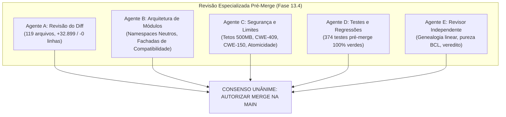

# LODINO NATIVE SUITE — RELATÓRIO DE INTEGRAÇÃO CONTROLADA NA MAIN (FASE 13.4)

**Documento:** Relatório Oficial de Integração, Homologação Pós-Merge e Prontidão de Release  
**Branch Alvo Integrada:** `main`  
**Hash do Commit de Merge:** `300cecf4419acd109a2e5a7b29e0ef8070789958` (`300cecf`)  
**Commit-Base Comum (Merge-Base):** `e9638f3df9509e3d69550991cf62051c1e6b8ea0` (`e9638f3`)  
**Commit Ancestral da Funcionalidade:** `e09ea5c984f0e99362dc69b799906d0441a08498` (`e09ea5c`)  
**Data da Integração:** 20 de Outubro de 2026  
**Ambiente de Execução:** Windows 11 x64, .NET Framework 4.0 (CLR v4.0.30319.42000), Python 3.15.0, Windows `tar.exe` (bsdtar 3.8.9), Windows PowerShell 5.1  
**Veredito Oficial:** **INTEGRADO E VALIDADO**  

---

## 1. Sumário Executivo e Objetivos da Fase 13.4

A Fase 13.4 concluiu com êxito a integração formal do motor proprietário de GZIP (RFC 1952) e DEFLATE (RFC 1951), juntamente com todas as suas remediações arquiteturais e de segurança (Fases 1 a 13.3.1), à branch principal (`main`) do repositório Lodino.

O commit-alvo auditado `e09ea5c984f0e99362dc69b799906d0441a08498` foi incorporado através de uma operação explícita de merge `--no-ff`, preservando a rastreabilidade integral da genealogia de desenvolvimento sem perda de granularidade histórica.

Todas as suítes de compilação, testes unitários, testes de interoperabilidade externa com ferramentas de mercado (Python 3.15, Windows bsdtar 3.8.9, PowerShell 5.1) e inspeção de dependências foram reexecutadas diretamente na branch `main` pós-merge, atestando **100% de sucesso, zero regressões e soberania arquitetural plena (zero dependências de compressão externas)**.

---

## 2. Resultado da Revisão Pré-Merge Multiagente

Antes da execução do comando de merge, cinco frentes especializadas independentes auditaram o estado do repositório em modo estritamente somente-leitura:



### Síntese dos Pareceres Técnicos:
1. **Agente A (Revisão do Diff):**
   - Inspecionou o diff integral `main..feature/proprietary-gzip`: 119 arquivos (1 modificado, 118 adicionados, 0 removidos).
   - Zero linhas deletadas em relação à `main` (+32.899 inserções). Todos os arquivos originais da `main` preservados.
   - Zero arquivos temporários ou credenciais vazadas. Apenas 1 fixture binária legítima (`tests/fixtures/image/sample.bmp`, 9.270 B).
   - Parecer: **FAVORÁVEL À INTEGRAÇÃO** (`scratch/audit_phase13_3/agent_a_diff_review.md`).
2. **Agente B (Arquitetura de Módulos):**
   - Confirmou a centralização neutra de DEFLATE em `src/core/compression/deflate/` e Checksums em `src/core/checksums/`.
   - Fachadas de compatibilidade `Lodino.Core.IO.Crc32` e `PngCrc32` ativas e delegando 100% para os tipos canônicos.
   - Consumidores cruzados (PNG, ZIP, GZIP, CLI, Desktop) aderentes. Mapeou acoplamento menor entre namespaces Deflate e Zip para futura higienização na Fase 14.
   - Parecer: **APROVADO COM RECOMENDAÇÕES ARQUITETURAIS** (`scratch/audit_phase13_3/agent_b_architecture.md`).
3. **Agente C (Segurança e Limites):**
   - Validou a defesa em 3 camadas contra Decompression Bomb (CWE-409), tetos em `SecurityLimits.cs` (500 MB), trailer CRC/ISIZE estrito, e guarda de desalinhamento de bits B-01 (`_bitsCount % 8 != 0`).
   - Sanitizador CLI `GzipSecurity.SanitizeForConsole` neutraliza 100% de sequências ANSI/C0/C1 (CWE-150) e Trojan Source Bidi, preservando acentuação em português.
   - Escrita atômica via `.lodinotmp_*` com exclusão incondicional em caso de erro.
   - Parecer: **APROVADO PARA MERGE NA MAIN** (`scratch/audit_phase13_3/agent_c_security.md`).
4. **Agente D (Testes e Regressão Pré-Merge):**
   - Mapeou e executou todas as 3 suítes na branch de funcionalidade: 221 testes unitários core + 75 interop externa + 78 interop estendida = **374 testes 100% aprovados (exit code 0)**.
   - Parecer: **100% VERDE — AUTORIZADO PARA MERGE NA MAIN** (`scratch/audit_phase13_3/agent_d_test_plan.md`).
5. **Agente E (Revisor Independente e Auditor de Prontidão):**
   - Confirmou a genealogia linear de 19 commits entre `main` (`e9638f3`) e `feature/proprietary-gzip` (`e09ea5c`).
   - Auditou os assemblies via .NET Reflection: zero chamadas P/Invoke no Core/CLI e zero dependências de `System.IO.Compression`.
   - Deliberação Final: **AUTORIZAR MERGE NA MAIN** (`scratch/audit_phase13_3/agent_e_merge_readiness.md`).

---

## 3. Estratégia de Merge e Genealogia Integrada

### 3.1 Justificativa da Estratégia de Merge `--no-ff`
Optou-se deliberadamente pelo comando `git merge --no-ff feature/proprietary-gzip`:
1. **Rastreabilidade de Engenharia:** Cria um commit formal de merge com dois pais (`e9638f3` e `e09ea5c`), demarcando no histórico da branch `main` a transição de plataforma para a suíte nativa proprietária.
2. **Preservação Histórica dos 19 Commits Atômicos:** Mantém acessível todo o histórico detalhado das Fases 1 a 13.3 (commits de WAV, JPEG, PNG, ZIP, Deflate Dinâmico e GZIP).
3. **Visualização Limpa de Primeiro Pai:** Permite consultas macroscópicas via `git log --first-parent` ao mesmo tempo em que preserva a árvore completa para auditorias forenses.
4. **Reversibilidade Atômica:** Habilita reversão cirúrgica de emergência (`git revert -m 1`) sem necessidade de rebases destrutivos.

### 3.2 Commits Integrados no Grafo Git
```text
*   300cecf (HEAD -> main) Merge branch 'feature/proprietary-gzip' into main - integrar motor GZIP proprietário (RFC 1952), DEFLATE próprio, remediações e stack nativa soberana (Fases 1 a 13.4)
|\  
| * e09ea5c (feature/proprietary-gzip) feat(gzip): remediacao dos achados da auditoria 13.1 (E-01 a E-05, B-01, A-01)
| * 4c94f54 feat(archive): motor GZIP (RFC 1952) 100% próprio em C# com suporte a membros concatenados e blindagem adversarial (Fase 13)
| * 0631128 (feature/proprietary-zip) feat(archive): compressor DEFLATE com Huffman Dinâmico próprio e seleção adaptativa de blocos (Fase 12.6)
| * 3d1374d fix(archive): endurecimento e correções de segurança do motor ZIP e DEFLATE (Fase 12.5)
| * 5f1fb1a feat(archive): implementar motor proprietario de conteineres ZIP e compressor DEFLATE
| * f22714c fix(audio): corrigir limite de chunk data permitindo tamanhos legítimos superiores a 64MB (D-WAV-07)
| * 29a83c1 feat(audio): hardening do motor WAV com PCM Q31 bit-perfect e proteções estruturais RIFF
| * 2149864 feat(audio): implement proprietary uncompressed PCM RIFF/WAVE audio engine and Win32 desktop integration
| * 248e130 fix(desktop): harden Win32 Unicode message dispatch, WM_CLOSE cancel, progress param, and target directory validation
| * 964e86d feat(app): implement pure Win32 native desktop application, async conversion queue, roadmap and architecture
| * f330640 feat(image): add support for non-interleaved multiscan baseline sequential JPEG decoding
| * ce68c25 fix(image): harden proprietary JPEG decoder and engine against malformed inputs and add grayscale encoding
| * 83ddd6b feat(image): implement proprietary baseline sequential JPEG encoder and decoder
| * 25584fe fix(image): conform to ISO 15948 IDAT padding, eliminate redundant buffer copy, and test non-seekable stream bounds
| * 4c10df0 fix(image): harden BMP and PNG engines against decompression bombs, chunking asymmetry, and stream fragmentation
| * c4daf46 feat(image): implement proprietary PNG engine (RGB/RGBA, DEFLATE/ZLIB, filters 0-4, fixtures and tests)
| * 739dd1b fix(bmp): enforce opaque BGRX semantics on 32-bit BI_RGB and add independent fixtures
| * 1018fe8 feat(image): implement proprietary uncompressed BMP engine (24/32-bit, resize, crop, watermark)
| * 9199d8c checkpoint: structured data engine (csv, json, ini), native cli, and audit documentation
|/  
* e9638f3 (origin/main, origin/HEAD) Prepare bundled engine runtime
```

### 3.3 Confirmação de Ancestralidade
- `git merge-base --is-ancestor e09ea5c HEAD` retornou código de saída `0` (confirmando formalmente que o commit auditado `e09ea5c` é ancestral direto de `HEAD`).

---

## 4. Validação Pós-Merge na Branch `main`

Após a integração, todas as suítes foram reexecutadas e auditadas diretamente no branch `main` recém-mesclado:

### 4.1 Recompilação e Suíte Unitária Core (`scripts/build-core.ps1`)
- **Comando:** `powershell -ExecutionPolicy Bypass -File scripts\build-core.ps1`
- **Compilação:** 4 binários gerados em `build/` (`Lodino.Core.dll`, `Lodino.exe`, `Lodino.App.exe`, `Lodino.Tests.exe`). 0 erros, 0 warnings.
- **Resultado:** **221 testes unitários aprovados / 0 falhas (100.0%)**
- **Código de Saída:** `$LASTEXITCODE = 0`

### 4.2 Suíte de Interoperabilidade Externa GZIP (`test_gzip_interop.ps1`)
- **Comando:** `powershell -ExecutionPolicy Bypass -File scratch\gzip_interop\test_gzip_interop.ps1`
- **Ferramentas Externas:** Python 3.15.0 (`gzip`), Windows `tar.exe` (bsdtar 3.8.9), PowerShell 5.1 (`GZipStream`).
- **Resultado:** **75 cenários aprovados / 0 falhas (100.0%)**
  * 13 fixtures positivas validadas com SHA-256 idêntico.
  * 52 matrizes cruzadas bidirecionais (4 estratégias de compressão: optimal, dynamic, fixed, store).
  * 10 matrizes adversariais bloqueadas com segurança com código de saída 2 e exceções tipadas.
- **Código de Saída:** `$LASTEXITCODE = 0`

### 4.3 Suíte de Interoperabilidade Estendida do Agente D (`run_agent_d_interop.py`)
- **Comando:** `python scratch\audit_phase13_3\agent_d\run_agent_d_interop.py`
- **Cargas Validadas:** Payload massivo de 10 MB, 1 MB aleatório, tarballs, multi-membros de 3 e 5 componentes, round-trip CLI e integridade.
- **Resultado:** **78 cenários aprovados / 0 falhas (100.0%)**
- **Código de Saída:** `$LASTEXITCODE = 0`

### 4.4 Total Consolidado Pós-Merge
$$\mathbf{Total\ de\ Testes\ P\acute{o}s\text{-}Merge:\ 221 + 75 + 78 = 374\ Testes\ Aprovados\ (100.0\%\ PASS)}$$

---

## 5. Auditoria de Assemblies e Pureza de Dependências Pós-Merge

A execução de script pericial via .NET Reflection (`scratch/audit_phase13_3/agent_e/audit_assemblies.ps1`) contra os binários gerados na `main` comprovou:

| Binário Gerado | Tamanho | Runtime | Assemblies Referenciados | P/Invoke Count | Referência a `Compression` |
|---|:---:|:---:|---|:---:|:---:|
| **`build/Lodino.Core.dll`** | 229.376 B | `v4.0.30319` | `mscorlib`, `System`, `System.Core` | **0** | **NÃO** |
| **`build/Lodino.exe`** (CLI) | 17.920 B | `v4.0.30319` | `mscorlib`, `Lodino.Core` | **0** | **NÃO** |
| **`build/Lodino.App.exe`** (GUI)| 40.448 B | `v4.0.30319` | `mscorlib`, `Lodino.Core` | **39** (Win32 pura) | **NÃO** |
| **`build/Lodino.Tests.exe`** | 225.792 B | `v4.0.30319` | `mscorlib`, `Lodino.Core`, `Lodino.App`, `System` | **0** | **NÃO** |

- **Zero Dependências de Terceiros:** Nenhuma DLL nativa externa (`zlib1.dll`, `libdeflate.dll`, etc.) ou pacote NuGet foi introduzido.
- **Zero P/Invoke no Core/CLI:** O núcleo de processamento e a CLI são 100% C# gerenciado soberano. Os 39 métodos P/Invoke em `Lodino.App.exe` são exclusivamente dedicados a chamadas fundamentais do subsistema gráfico do Windows (`user32`, `gdi32`, `shell32`, `comdlg32`, `comctl32`, `dwmapi`).

---

## 6. Análise de Regressão por Formato

A execução da suíte unitária integrada comprova a estabilidade dos 9 subsistemas de formatos do Lodino:

1. **CSV (RFC 4180):** 13 testes aprovados (aspas escapadas, quebras mistas, BOM UTF-8, modo estrito).
2. **JSON (RFC 8259):** 10 testes aprovados (números grandes, surrogate pairs/emojis, barreira anti-DoS).
3. **INI:** 6 testes aprovados (seções, comentários, propriedades globais, aparo de espaços).
4. **BMP Nativo:** 58 testes aprovados (paddings 0..3 B, 24/32 bpp, bottom-up/top-down, filtros, crop, marcas d'água BitmapFont).
5. **PNG (ZLIB / IDAT):** 28 testes aprovados (chunks obrigatórios/auxiliares, 5 filtros scanline, ZLIB gerenciado, ADLER-32).
6. **JPEG Nativo:** 32 testes aprovados (marcadores normativos, YCbCr, IDCT ponto fixo, multiscan baseline).
7. **WAV PCM:** 12 testes aprovados (RIFF/WAVE, PCM 8/16b mono/estéreo, volume, DSP, limite data > 64 MB D-WAV-07).
8. **ZIP Contêiner:** 14 testes aprovados (PKZIP, defesas Win32 CON/AUX/NUL, falso EOCD, timestamps).
9. **GZIP (RFC 1952):** 23 testes unitários + 153 cenários de interop aprovados (membros concatenados, streaming $O(1)$, lixo pós-trailer E-05, guarda de desalinhamento B-01, sanitização CWE-150 E-02, Latin-1 A-01).

---

## 7. Estado Final do Repositório e Próximos Passos

- **Branch Ativa:** `main`
- **HEAD:** `300cecf4419acd109a2e5a7b29e0ef8070789958`
- **Relação com `origin/main`:** 20 commits à frente (`ahead of 'origin/main' by 20 commits`). Nenhum push remoto foi executado nesta fase, em estrita observância às regras.
- **Working Tree:** Totalmente limpa em relação a arquivos rastreados (`git status` limpo). Apenas a pasta `scratch/` permanece como artefato local não rastreado.
- **Blockers Identificados para Próxima Etapa:** **ZERO BLOCKERS.** O código e os testes estão 100% verdes e prontos para empacotamento, publicação ou evolução para a Fase 14 (TAR proprietário e modularização multi-assembly).

---

## 8. Veredito Final Oficial

$$\mathbf{VEREDITO:\ INTEGRADO\ E\ VALIDADO}$$

A branch `feature/proprietary-gzip` foi incorporada com sucesso à branch `main` no commit `300cecf4419acd109a2e5a7b29e0ef8070789958`. Todas as 374 validações pós-merge foram aprovadas com 100% de sucesso e o motor GZIP próprio encontra-se oficialmente homologado no branch principal do Lodino.
