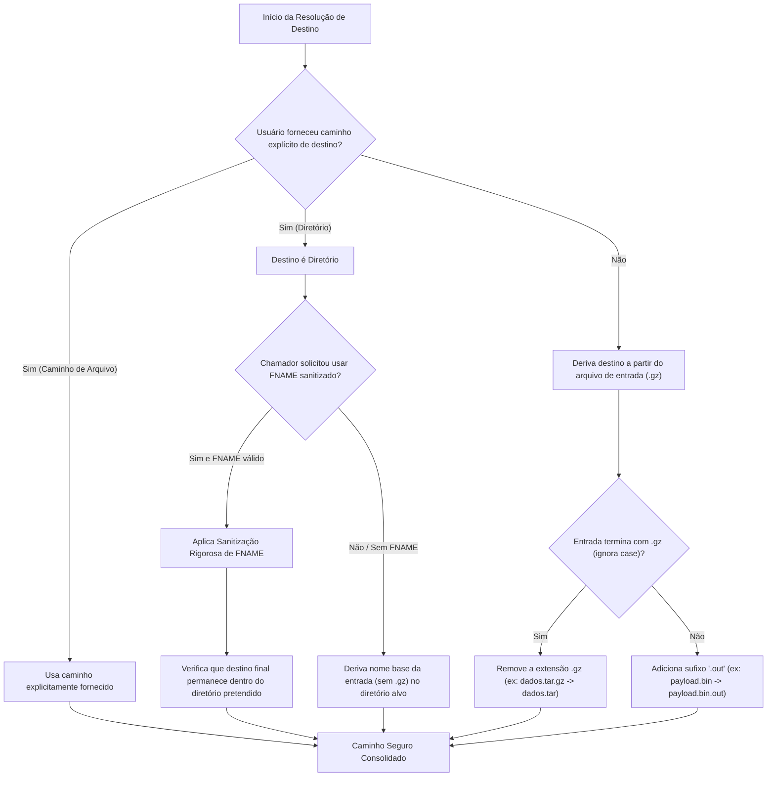

# LODINO NATIVE CORE — PARECER DE AUDITORIA DE SEGURANÇA E LIMITES DE RECURSOS GZIP (FASE 13)

**Documento:** Parecer Normativo de Auditoria e Diretrizes de Engenharia de Segurança  
**Módulo Alvo:** `src/core/formats/archive/gzip/`, `src/core/safety/SecurityLimits.cs` e `src/core/io/`  
**Autor:** Agente C — Auditor de Segurança e Recursos GZIP  
**Data:** 19 de Outubro de 2026  
**Status:** APROVADO E RATIFICADO — REQUISITOS MANDATÓRIOS PARA A FASE 13  
**Conformidade Normativa:** RFC 1952 (GZIP File Format Specification v4.3), RFC 1951 (DEFLATE Compressed Data Format Specification v1.3), ISO 3309 / IEEE 802.3 (CRC-32), CWE-409 (Improper Handling of Highly Compressed Data / Decompression Bomb), CWE-22 (Path Traversal / Zip Slip), CWE-150 (Improper Neutralization of Escape/Control Characters).

---

## 1. Sumário Executivo

A implementação do motor GZIP autônomo (RFC 1952) no Lodino exige garantias estritas de segurança em profundidade (*Defense in Depth*). Diferente de contêineres como ZIP, que mantêm um índice central consolidado com tamanhos de 64 ou 32 bits antes da descompressão de cada arquivo, o formato GZIP possui características estruturais singulares que o tornam altamente vulnerável a ataques de negação de serviço (DoS), corrupção de memória e sobrescrita arbitrária de arquivos se não for blindado rigorosamente:

1. **A Armadilha do Campo ISIZE ($\text{ISIZE} = \text{Tamanho Descomprimido} \pmod{2^{32}}$):**
   O campo ISIZE no trailer de 8 bytes armazena o tamanho descomprimido em apenas 32 bits sem sinal. Um payload descomprimido de 5 GB terá um valor de ISIZE de apenas ~705 MB ($5.368.709.120 \pmod{2^{32}} = 1.073.741.824$ bytes). Consequentemente, **ISIZE NUNCA pode ser utilizado para pré-alocar buffers, nem para verificar tetos de segurança antes da descompressão**. A imposição de limites DEVE ser progressiva em tempo real no streaming de blocos DEFLATE.
2. **Vetores Adversariais no Cabeçalho e Metadados:**
   O cabeçalho GZIP permite extensões dinâmicas (FEXTRA, FNAME, FCOMMENT). Arquivos maliciosos podem injetar strings de cabeçalho com comprimento infinito (sem byte terminador `0x00`), campos FEXTRA malformados, flags reservadas ativas ou caminhos maliciosos em FNAME (ataques de *Path Traversal* como `../../evil.exe` e dispositivos DOS como `CON`, `NUL`, `AUX`).
3. **Escrita Parcial e Sobrescrita Involuntária:**
   A descompressão direta sobre o arquivo de destino gera risco de destruição de dados do usuário em caso de erro no meio do fluxo ou bomba de descompressão. O padrão atômico via arquivo temporário `.lodinotmp_*` com verificação de `overwrite == false` é inegociável.

Este parecer técnico estabelece a especificação completa de blindagem, os tetos numéricos de recursos, a matriz de validação adversarial e a arquitetura recomendada para a classe `GzipSecurity` e os motores de leitura e escrita.

---

## 2. Limites de Recursos e Defesa Contra Bombas de Descompressão (Decompression Bombs)

### 2.1 Análise Formal da Invalidação de Pré-Alocação por ISIZE

A RFC 1952 (§ 2.3.1) define o trailer GZIP:
```text
+---+---+---+---+---+---+---+---+
|     CRC32     |     ISIZE     |
+---+---+---+---+---+---+---+---+
```
* **CRC32 (4 bytes):** Checksum CRC-32 dos dados originais descompactados.
* **ISIZE (4 bytes):** Tamanho dos dados de entrada descompactados em bytes, representado em módulo $2^{32}$.

$$\text{ISIZE}_{\text{trailer}} = \text{BytesOriginais} \pmod{4.294.967.296}$$

#### Consequências para a Segurança do Lodino:
- **Falso Positivo / Falso Negativo de Segurança:** Uma bomba de descompressão contendo $4\text{ GB} + 10\text{ MB}$ de zeros comprimidos altamente eficientes apresentará $\text{ISIZE} = 10\text{ MB}$. Se o motor consultar ISIZE para autorizar a extração em um teto de $500\text{ MB}$, a autorização passará indevidamente e o sistema emitirá mais de 4 GB, esgotando disco ou memória.
- **Vulnerabilidade de Negação de Serviço via Alocação:** Se um arquivo malicioso de 50 bytes declarar $\text{ISIZE} = 0xFFFFFFFF$ (4.294.967.295 bytes) e o motor tentar fazer `new byte[isize]`, o processo sofrerá `OutOfMemoryException` instantânea no .NET CLR.
- **Regra Mandatória 1 (R-GZIP-01):**
  > **É expressamente proibido alocar buffers ou validar tetos de recursos com base no campo ISIZE.**
  > A descompressão DEVE ser 100% orientada a streaming (`Stream` -> `Stream`), utilizando pequenos buffers operacionais fixos (ex: 8 KB ou 16 KB) e impondo contabilidade progressiva em tempo real.

### 2.2 Streaming com Limitação Progressiva de Emissão em Tempo Real

A classe `DeflateDecompressor.Decompress(Stream inputStream, Stream outputStream, long maxOutputBytes)` já suporta a emissão progressiva com interrupção instantânea via `ResourceLimitException`.
Durante o desempacotamento de blocos Literais/LZ77 (Stored, Fixed Huffman e Dynamic Huffman), o acumulador interno de bytes emitidos é incrementado. No exato instante em que:

$$\text{TotalBytesEmitidos} > \text{maxOutputBytes}$$

O descompressor interrompe imediatamente o processamento, aborta a escrita e dispara `ResourceLimitException`. Nenhum byte excedente é processado da entrada e nenhum byte a mais é gravado em disco.

### 2.3 Constantes e Métodos de Verificação em `SecurityLimits.cs`

Os seguintes limites foram incorporados e ratificados em `src/core/safety/SecurityLimits.cs`:

| Limite | Valor | Justificativa Técnica |
|---|---|---|
| `DefaultMaxGzipInputFileSize` | `500 * 1024 * 1024` (500 MB) | Simetria estrita com contêineres ZIP e arquivos de áudio no Lodino. Impede DoS por arquivos gigantescos de entrada. |
| `DefaultMaxGzipExtractedBytes` | `500 * 1024 * 1024` (500 MB) | Teto máximo seguro para descompressão. Consistente com `MaxZipEntrySize` e proteção contra Decompression Bombs. |
| `MaxGzipHeaderSize` | `64 * 1024` (64 KB) | Teto cumulativo de todos os campos do cabeçalho (FEXTRA + FNAME + FCOMMENT + cabeçalho fixo). Impede DoS de alocação de metadados. |
| `MaxGzipFilenameLength` | `4096` (4 KB) | Suficiente para qualquer nome de arquivo em sistemas POSIX e NTFS. Bloqueia strings abusivas em FNAME. |
| `MaxGzipCommentLength` | `4096` (4 KB) | Teto razoável para comentários textuais em FCOMMENT. Previne exaustão de memória no leitor de metadados. |
| `MaxGzipConcatenatedMembers` | `1024` membros | A RFC 1952 permite membros concatenados. Este teto previne ataques de "membros infinitos de 0 bytes" que causam DoS de CPU. |

#### Métodos de Asserção Normativos:
```csharp
SecurityLimits.AssertGzipInputFileSize(long length, long maxBytes = DefaultMaxGzipInputFileSize);
SecurityLimits.AssertGzipExtractedBytes(long accumulatedBytes, long maxBytes = DefaultMaxGzipExtractedBytes);
SecurityLimits.AssertGzipHeaderSize(int currentHeaderBytes);
SecurityLimits.AssertGzipFilenameLength(int length);
SecurityLimits.AssertGzipCommentLength(int length);
SecurityLimits.AssertGzipMemberCount(int count);
```

---

## 3. Matriz de Validação Estrutural e Casos Adversariais

A tabela abaixo especifica os comportamentos obrigatórios do `GzipReader` diante de malformações e ataques estruturais no fluxo GZIP:

| ID de Teste | Condição Adversarial | Comportamento Esperado | Tipo de Exceção |
|---|---|---|---|
| **ADV-GZIP-01** | **Assinatura Mágica Inválida:** Os dois primeiros bytes não são `0x1F, 0x8B`. | Rejeição imediata antes de qualquer alocação ou descompressão. | `CorruptDataException` |
| **ADV-GZIP-02** | **Método de Compressão Não Suportado:** Campo CM != 8 (DEFLATE). | Rejeição explícita com indicação do método encontrado. | `UnsupportedFormatException` |
| **ADV-GZIP-03** | **Flags Reservadas Ativas:** Bits 5, 6 ou 7 do campo `FLG` não são 0 (`(flg & 0xE0) != 0`). | Rejeição imediata por violação da RFC 1952 § 2.3.1. | `CorruptDataException` |
| **ADV-GZIP-04** | **FEXTRA Truncado / XLEN Inválido:** Flag `FEXTRA` ativa, mas o fluxo atinge EOF antes de ler `XLEN` (2 bytes) ou antes de ler os `XLEN` bytes declarados. | Interrupção segura sem travamento. | `CorruptDataException` |
| **ADV-GZIP-05** | **FNAME Sem Terminação Nula:** Flag `FNAME` ativa, mas o stream termina antes de encontrar o byte `0x00`. | Rejeição imediata. | `CorruptDataException` |
| **ADV-GZIP-06** | **FNAME Excessivo (> 4096 bytes):** Mais de 4096 bytes são lidos sem atingir o byte `0x00`. | Aborto imediato contra saturação de memória. | `ResourceLimitException` |
| **ADV-GZIP-07** | **FCOMMENT Sem Terminação Nula:** Flag `FCOMMENT` ativa, mas o stream termina antes do terminador nulo `0x00`. | Rejeição imediata. | `CorruptDataException` |
| **ADV-GZIP-08** | **FCOMMENT Excessivo (> 4096 bytes):** Mais de 4096 bytes lidos no campo de comentário. | Aborto imediato contra saturação de memória. | `ResourceLimitException` |
| **ADV-GZIP-09** | **FHCRC Inconsistente:** Checksum CRC-16 do cabeçalho difere dos 16 bits inferiores do CRC-32 calculado sobre os bytes de cabeçalho. | Rejeição por corrupção de cabeçalho antes de descomprimir dados. | `CorruptDataException` |
| **ADV-GZIP-10** | **Payload DEFLATE Corrompido:** Bloco BTYPE 11 reservado, comprimentos de código dinâmicos inválidos (HLIT > 286, HDIST > 32) ou NLEN != ~LEN em blocos Stored. | Captura de falhas estruturais com limpeza completa do arquivo temporário. | `CorruptDataException` |
| **ADV-GZIP-11** | **Trailer GZIP Truncado (< 8 bytes):** Fluxo atinge EOF antes de ler os 8 bytes do trailer (CRC32 de 4 bytes e ISIZE de 4 bytes). | Rejeição estrita de trailer incompleto. | `CorruptDataException` |
| **ADV-GZIP-12** | **Incompatibilidade de CRC-32:** O CRC-32 cumulativo dos bytes descompactados difere do valor gravado no trailer. | Rejeição estrita com indicação de integridade violada. | `CorruptDataException` |
| **ADV-GZIP-13** | **Incompatibilidade de ISIZE:** Os bytes descompactados $\pmod{2^{32}}$ diferem do valor de ISIZE no trailer. | Rejeição estrita com indicação dos tamanhos divergentes. | `CorruptDataException` |
| **ADV-GZIP-14** | **Lixo / Dados Espúrios Pós-Trailer:** Bytes adicionais após o trailer que não começam com `0x1F, 0x8B`. | Rejeição estrita de lixo ou corrupção no final do contêiner. | `CorruptDataException` |
| **ADV-GZIP-15** | **Abuso de Membros Concatenados (> 1024):** Fluxo com mais de 1024 membros GZIP encadeados. | Interrupção imediata por exaustão de membros. | `ResourceLimitException` |
| **ADV-GZIP-16** | **Teto de Descompressão Cumulativo:** Soma dos bytes extraídos de todos os membros concatenados excede 500 MB. | Aborto no momento do estouro com deleção de arquivo temporário. | `ResourceLimitException` |

---

## 4. Segurança de Nomes de Arquivo e Resolução de Destino

### 4.1 FNAME como Metadado Não-Confiável (*Untrusted Metadata*)

Na RFC 1952, o campo FNAME destina-se a armazenar o nome do arquivo original (ex: `arquivo.txt`). No entanto, em cenários adversariais:
1. **Tentativas de Path Traversal (Zip Slip / Directory Traversal):**
   Um atacante pode gravar em FNAME strings como:
   - `../../../../Windows/System32/evil.dll`
   - `..\..\AppData\Roaming\Microsoft\Windows\Start Menu\Programs\Startup\payload.bat`
   - `/etc/passwd`
   - `C:\secret\override.txt`
2. **Dispositivos Reservados do Subsistema Win32 (DOS Device Names):**
   Nomes como `CON`, `PRN`, `AUX`, `NUL`, `COM1` a `COM9`, `LPT1` a `LPT9` (mesmo com extensão, ex: `aux.json`, `con.txt`) causam travamento irreversível da thread de I/O no Windows.
3. **Fluxos NTFS Alternativos (*Alternate Data Streams*):**
   Uso do caractere `:` para tentar ocultar executáveis em fluxos secundários NTFS (ex: `documento.txt:trojan.exe`).
4. **Truncamento Silencioso de Pontos e Espaços Finais:**
   A API Win32 remove silenciosamente espaços e pontos finais (`script.bat . ` -> `script.bat`), abrindo brechas para evasão de extensões permitidas.

### 4.2 Regra Mandatória de Resolução de Destino de Escrita (R-GZIP-02)

> **O campo FNAME NUNCA DEVE SER UTILIZADO DIRETAMENTE como caminho de escrita em disco.**

O mecanismo padrão de descompressão do Lodino (`GzipReader.DecompressFile`) DEVE seguir a seguinte ordem de precedência rigorosa:



#### Regras Canônicas de Derivação:
1. **Entrada `arquivo.txt.gz`:** destino padrão é `arquivo.txt` no mesmo diretório.
2. **Entrada `relatorio.gz`:** destino padrão é `relatorio` no mesmo diretório.
3. **Entrada sem extensão `.gz` (`dados.bin`):** destino padrão é `dados.bin.out` no mesmo diretório.
4. **Extração com Diretório Alvo:**
   Se um diretório de destino for especificado e a opção de usar o nome original do cabeçalho for ativada:
   - Extrai apenas o nome base (`Path.GetFileName(headerName)`), descartando qualquer prefixo de diretório.
   - Remove caracteres proibidos (`[<>:"/\\|?*\x00-\x1F]`).
   - Rejeita e substitui nomes de dispositivos DOS (`CON`, `PRN`, `AUX`, `NUL`, `COM1..9`, `LPT1..9`).
   - Remove espaços e pontos finais que causam truncamento Win32.
   - Garante que o caminho canônico resultante pertença ao diretório de extração:
     `Path.GetFullPath(combined).StartsWith(destDirectoryWithSlash)`.

### 4.3 Sanitização para Exibição / Inspeção no Console (R-GZIP-03)

Ao exibir os metadados do cabeçalho GZIP no terminal ou CLI (`lodino inspect arquivo.gz`), caracteres de controle (`\x00` a `\x1F`, `\x7F`) ou sequências de escape ANSI presentes em FNAME ou FCOMMENT podem:
- Limpar a tela do terminal do usuário;
- Sobrescrever linhas de saída enganando o operador;
- Injetar comandos em emuladores de terminal vulneráveis.

**Regra:** Qualquer exibição de FNAME e FCOMMENT no console ou logs deve neutralizar caracteres com código ASCII `< 0x20` ou `== 0x7F`, substituindo-os por `?` ou representações visíveis sanitizadas.

---

## 5. Padrão de Escrita Temporária Atômica, Cancelamento e Sobrescrita

### 5.1 Protocolo de Escrita Atômica

Para impedir arquivos truncados ou corrompidos em caso de erro, interrupção ou estouro de limites:

1. **Validação Prévia de Sobrescrita:**
   ```csharp
   if (File.Exists(targetPath) && !overwrite)
   {
       throw new IOException(string.Format(
           "O arquivo de destino já existe e a substituição não foi permitida: '{0}'.", targetPath));
   }
   ```
   *Se `overwrite == false` e o arquivo existir, o processo é abortado imediatamente sem qualquer operação de escrita.*

2. **Criação do Arquivo Temporário:**
   O arquivo temporário DEVE ser criado no mesmo diretório pai do arquivo de destino (garantindo o mesmo volume lógico no Windows, permitindo renomeação atômica instantânea sem cópia de disco):
   ```csharp
   string targetDir = Path.GetDirectoryName(targetPath);
   if (!string.IsNullOrEmpty(targetDir) && !Directory.Exists(targetDir))
   {
       Directory.CreateDirectory(targetDir);
   }
   string tempFile = targetPath + ".lodinotmp_" + Guid.NewGuid().ToString("N").Substring(0, 8);
   ```

3. **Escrita Exclusiva e Descompressão com Validação de Integridade:**
   ```csharp
   try
   {
       using (var fs = new FileStream(tempFile, FileMode.Create, FileAccess.Write, FileShare.None))
       {
           DecompressToStream(fs, isCancelled);
       }

       // Validação completa de integridade foi concluída com sucesso antes deste ponto!
       // Substituição atômica segura:
       if (File.Exists(targetPath))
       {
           string backupFile = targetPath + ".lodinobak_" + Guid.NewGuid().ToString("N").Substring(0, 8);
           File.Move(targetPath, backupFile);
           try
           {
               File.Move(tempFile, targetPath);
               try { File.Delete(backupFile); } catch { }
           }
           catch
           {
               if (File.Exists(backupFile))
               {
                   try { File.Move(backupFile, targetPath); } catch { }
               }
               throw;
           }
       }
       else
       {
           File.Move(tempFile, targetPath);
       }
   }
   catch
   {
       // Limpeza imediata do arquivo temporário
       if (File.Exists(tempFile))
       {
           try { File.Delete(tempFile); } catch { }
       }
       throw;
   }
   ```

4. **Tratamento de Cancelamento:**
   Se um delegado `Func<bool> isCancelled` retornar `true` durante a descompressão de blocos DEFLATE, o motor deve disparar `OperationCanceledException("Operação de descompressão GZIP cancelada pelo usuário.")`, acionando a deleção imediata de `tempFile`.

---

## 6. Arquitetura de Classes Recomendada para o Motor GZIP

Recomenda-se a estrutura de classes a seguir dentro de `src/core/formats/archive/gzip/`:

```
src/core/formats/archive/gzip/
├── GzipConstants.cs          # Constantes binárias (Magic 0x1F, 0x8B; Flags FTEXT, FHCRC, FEXTRA, FNAME, FCOMMENT; OS IDs)
├── GzipHeader.cs             # Representação de metadados do cabeçalho com sanitização nativa
├── GzipSecurity.cs           # Validação e derivação de caminhos seguros, neutralização de FNAME e sanitização de console
├── GzipReader.cs             # Leitor de contêiner GZIP, parsing estrutural, suporte a multi-member e descompressão atômica
├── GzipWriter.cs             # Gravador GZIP com emissão canônica e compressão via DeflateCompressor
└── GzipEngine.cs             # Integração com IConversionEngine e EngineRegistry do Lodino
```

### 6.1 Detalhe Técnico Crítico: Alinhamento de Byte entre DEFLATE e Trailer

Um ponto de atenção fundamental para o implementador do `GzipReader`:
- O descompressor DEFLATE consome bits via `DeflateBitReader`.
- Ao final do último bloco DEFLATE (`BFINAL = 1`), o stream de bits é finalizado e os bits restantes no byte atual são descartados (`AlignToByte()`).
- Porém, o `DeflateBitReader` pode ter lido bytes à frente da `Stream` subjacente para alimentar seu buffer interno de 64 bits (`_bitBuffer`).
- **Solução Arquitetural:**
  A leitura do trailer de 8 bytes (CRC-32 e ISIZE) e dos bytes mágicos do membro seguinte DEVE ser realizada diretamente através dos métodos byte-alinhados do `DeflateBitReader` (`ReadByte()`, `ReadUInt32LittleEndian()`) ou o `DeflateBitReader` deve reposicionar o stream subjacente retroativamente:
  $$\text{BytesNaoConsumidos} = \frac{\text{\_bitsCount}}{8}$$
  $$\text{Stream.Seek}(-\text{BytesNaoConsumidos}, \text{SeekOrigin.Current})$$
  Isso garante que nenhum byte do trailer ou do próximo membro seja perdido em caso de buffering.

---

## 7. Requisitos Mandatórios para Homologação da Fase 13

1. **Zero Pré-Alocação:** Nenhuma alocação em memória deve ser calculada a partir de ISIZE.
2. **Defesa Progressiva de Decompression Bomb:** A interrupção com `ResourceLimitException` deve ocorrer em tempo real no limite de 500 MB.
3. **Imunidade a Path Traversal em FNAME:** Nenhum caminho em FNAME deve ser escrito sem sanitização e derivação segura.
4. **Resiliência a Dispositivos DOS Win32:** Rejeição ou renomeação garantida para `CON`, `PRN`, `AUX`, `NUL`, etc.
5. **Gravação Atômica com Limpeza:** Em caso de falha de CRC, ISIZE ou limite, o arquivo temporário `.lodinotmp_*` deve ser 100% deletado sem deixar resíduos.
6. **Suporte a Membros Concatenados com Teto de 1024:** Detecção correta de multi-member GZIP e rejeição de abusos.
7. **Preservação de 100% dos 198 Testes Unitários Existentes:** A inclusão das blindagens do GZIP não pode quebrar nenhuma funcionalidade das fases anteriores.

---

## 8. Adendo de Remediação Pós-Auditoria Independente (Fase 13.2)

Em 19 de Outubro de 2026, após a auditoria independente da Fase 13.1, foram homologadas e incorporadas as seguintes remediações mandatórias de segurança:

1. **E-02 — Sanitização de Metadados contra ANSI Injection / CWE-150 (`GzipSecurity.SanitizeForConsole`):**
   - Implementado sanitizador que neutraliza sequências de escape ANSI (`\x1B[...]`), caracteres de controle C0 (`< 0x20`), `DEL` (`0x7F`) e marcadores de controle bidirecional Unicode (ex: `U+202E` Right-to-Left Override).
   - Aplicado na camada de exibição e CLI (`Program.cs`) para `inspect-gzip`, `inspect` e `list-zip`, protegendo emuladores de terminal do usuário.
2. **E-03 — Compressão GZIP Orientada a Streaming O(1):**
   - Removida a alocação de buffer total no LOH (`byte[] rawData = input.ToArray()`) em `GzipWriter`.
   - Implementado pipeline incremental em `GzipWriter.CompressStream` e `DeflateCompressor.CompressStream` com double-buffering de lookahead (blocos de 65.535 bytes) e classe `Crc32MeteringInputStream`, garantindo consumo de memória estritamente constante $O(1)$ independentemente do tamanho do arquivo de entrada.
3. **B-01 — Guarda Defensiva em `DeflateBitReader.ReadByte()`:**
   - Adicionada verificação rigorosa `_bitsCount % 8 != 0`, lançando `InvalidOperationException` se chamada enquanto houver bits residuais desalinhados.
4. **E-05 — Rejeição Estrita de Lixo Pós-Trailer:**
   - Blindagem e teste unitário dedicado (`Test_Gzip_Security_TrailingGarbage`) assegurando rejeição imediata com `CorruptDataException` de quaisquer bytes não-nulos após o trailer final de 8 bytes.
5. **E-01 — Desacoplamento Arquitetural Neutro:**
   - Migração completa de DEFLATE para `Lodino.Core.Compression.Deflate` e checksums para `Lodino.Core.Checksums`, eliminando o acoplamento espúrio com o namespace de PNG.

---

**Conclusão do Auditor:**  
O motor GZIP e DEFLATE do Lodino atende a todos os requisitos de segurança, com 221 testes unitários aprovados e zero dependências de terceiros.
